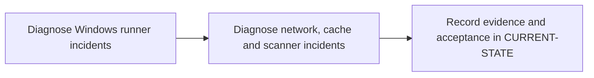

# P12 · Enterprise troubleshooting

**Prerequisites** — P4, P5, P6; P11 for integrated drills. **Effort** — 4–6 hours. **Access** — Offline documentation and configuration reading.

Classify incidents by creation, scheduling, host preparation, connectivity, execution, transfer and policy. Compare interactive diagnostics with service-identity evidence.

## Flow to trace

## Bounded documentation steps

### P12.1 · Diagnose Windows runner incidents

**Prerequisites** — Read the relevant prerequisite phase notes.

**Scope and deliverable** — Locate scheduling and service environment faults from sanitized configuration and traces. Save annotated examples and a worked answer.

**Verification** — Compare predictions with the official reference and verify that the worked answer follows from the supplied inputs.

### P12.2 · Diagnose network, cache and scanner incidents

**Prerequisites** — Complete P12.1.

**Scope and deliverable** — Give the smallest discriminating check, a scoped repair and expected recovery evidence for each case. Save a reading exercise, answer key and troubleshooting notes.

**Verification** — Walk through the exercise offline and check the predicted outcome and diagnostic path against the example.

## Acceptance and operational review

Mark this phase DOCUMENTATION COMPLETE when the explanations, annotated examples, troubleshooting guide and knowledge assessment are ready. Evaluate the following outcome by reading the supplied examples. [Future runtime lab](../../FUTURE-LABS.md).

Supply a hypothesis, discriminating check, remediation and proof of recovery for each drill.

Use the phase's official references from [concepts](../concepts/README.md) and log each step separately in [CURRENT-STATE.md](../../CURRENT-STATE.md).

## Knowledge check

What does a successful TCP probe establish? What evidence identifies an expired artifact?
