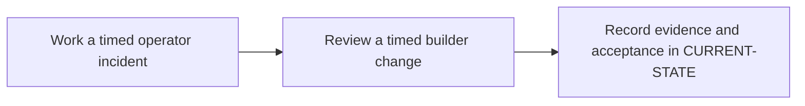

# P13 · Enterprise readiness assessment

**Prerequisites** — P7, P11, P12. **Effort** — 3–5 hours. **Access** — Offline documentation and configuration reading.

Use realistic change requests and incidents to evaluate independent operator and builder competence. Record what evidence is sufficient for each skill.

## Flow to trace

## Bounded documentation steps

### P13.1 · Work a timed operator incident

**Prerequisites** — Read the relevant prerequisite phase notes.

**Scope and deliverable** — Classify a hidden failure using a provided graph and trace, then document a safe response. Save annotated examples and a worked answer.

**Verification** — Compare predictions with the official reference and verify that the worked answer follows from the supplied inputs.

### P13.2 · Review a timed builder change

**Prerequisites** — Complete P13.1.

**Scope and deliverable** — Propose a configuration diff, predict outcomes for two events, and score the design, evidence plan and rollback. Save a reading exercise, answer key and troubleshooting notes.

**Verification** — Walk through the exercise offline and check the predicted outcome and diagnostic path against the example.

## Acceptance and operational review

Mark this phase DOCUMENTATION COMPLETE when the explanations, annotated examples, troubleshooting guide and knowledge assessment are ready. Evaluate the following outcome by reading the supplied examples. [Future runtime lab](../../FUTURE-LABS.md).

Meet the offline rubric and explain what evidence would establish runtime behavior.

Use the phase's official references from [concepts](../concepts/README.md) and log each step separately in [CURRENT-STATE.md](../../CURRENT-STATE.md).

## Knowledge check

How do you prove a change restored service without weakening a gate?
