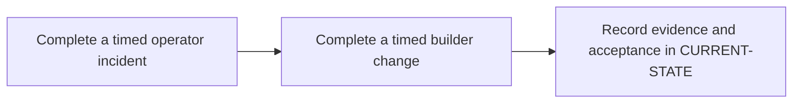

# P13 · Enterprise readiness assessment

**Prerequisites** — P7, P11, P12. **Effort** — 3–5 hours. **Access** — Local + GitLab + Windows; Vendor for live sign-off.

Use realistic change requests and incidents to evaluate independent operator and builder competence. Record what evidence is sufficient for each skill.

## Flow to trace

## Bounded implementation steps

### P13.1 · Complete a timed operator incident

**Prerequisites** — Roadmap reviewed and phase dependencies met. Confirm access for the specific lab before starting.

**Scope and deliverable** — Perform the first exercise in the phase and save a reproducible lab note under [labs](../labs/README.md), including sanitized inputs and observed output.

**Verification and expected result** — Diagnose one hidden failure in a sanitized existing pipeline and give a safe mitigation, an owner and a verification step.

### P13.2 · Complete a timed builder change

**Prerequisites** — Complete P13.1 and confirm access for the second exercise.

**Scope and deliverable** — Perform the second exercise in isolation, then save the lab instructions, expected results, and a troubleshooting note for the demonstrated failure.

**Verification and expected result** — Modify a sandbox pipeline, run lint and two execution scenarios, and provide a rollback plan. Score with the assessment rubric and note live/simulation coverage.

## Acceptance and operational review

Accept P13.1 when its verification is reproducible from the recorded inputs. Accept P13.2 when its verification is repeatable and the learner can meet this phase outcome.

Meet the rubric and explain the next step for every unmet live prerequisite.

Use the phase's official references from [concepts](../concepts/README.md) and log each step separately in [CURRENT-STATE.md](../../CURRENT-STATE.md).

## Knowledge check

How do you prove a change restored service without weakening a gate?
