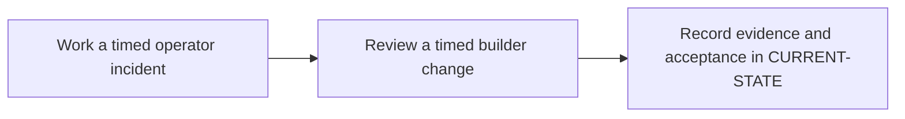

# P13 · Enterprise readiness assessment

**Study effort** — 3–5 hours. **Access** — Offline documentation and configuration reading.

## Purpose and enterprise relevance

Use realistic change requests and incidents to evaluate independent operator and builder competence. Record what evidence is sufficient for each skill.

**Operational target** — L3. Propose and defend a safe diff across two events with a rollback plan. Diagnose a timed incident with evidence and apply calibrated rubric and remediation.

## Prerequisites

- **Mandatory** — P7, P11, P12. Use P7, P11 and P12 for migration, gate and incident reasoning.
- **Optional** — Use earlier labs selectively to remediate weak competency areas.
- Use the [concept index](../concepts/README.md) for source and version notes. Dependency checks concern the prerequisite knowledge listed here. A learner can use the existing material while earlier expansion work is pending.

## Layer A · Knowledge Base deliverables

**PLANNED chapter** — `docs/concepts/readiness-and-evidence-model.md`

**Subject and learning objective** — Enterprise readiness and evidence quality. Build a mental model that transfers across enterprise configurations and failure paths.

### Planned chapter hierarchy

1. **Concepts and definitions.** Define capability, observable evidence, competency level, rubric, threshold, calibration and learning gap. Explain how knowledge, configuration reasoning and incident judgment relate before introducing any assessment fixture. For each major concept, state why it exists, what problem it solves, what it owns and what it is commonly confused with.
2. **Responsibilities, relationships and usage.** Distinguish learner, reviewer and operations-owner responsibilities. Compare formative feedback and readiness decisions, offline evidence and live sign-off, and tradeoffs between breadth, depth and calibration effort.
3. **Architecture and internal execution.** Plan a competency-to-evidence map and a sequence from evidence selection through scoring, feedback and reassessment. Include unsafe answers, incomplete evidence, reviewer disagreement and scope limitations.
4. **Configuration and enterprise application.** Explain rubric ownership, scoring dimensions, minimum safe behavior, versioned fixtures and escalation criteria. Reconcile the distinct existing assessment instruments without assuming their scores are equivalent. Explain documentation evidence versus live operation, reviewer agreement, safety criteria and remediation of gaps.
5. **Selected illustrations.** Select a worked evidence packet to illustrate review and calibration. Keep unseen assessment inputs separate from teaching examples. Present these after the relevant explanation and use Layer B for the full reference.
6. **Conclusions and knowledge checks.** Synthesize readiness as a supported decision with explicit limits. Ask what evidence closes a learning gap and what still needs live sign-off. Direct readers back to the relevant phase concepts.

**Dependencies and reuse** — Use the mandatory prerequisite knowledge above. Consult [competency rubric](../competency-levels/04-SUMMARY-VALIDATION.md), [readiness assessment](../../assessments/README.md), [cheat sheets](../cheat-sheets/README.md) and [enterprise scenarios](../enterprise-scenarios/README.md) for existing explanations, diagrams or later assessment alignment. Set chapter coverage from the hierarchy above and verify technical claims against authoritative references.

**Knowledge acceptance** — Explain the purpose, boundaries, interactions and material alternatives across the hierarchy. Diagrams and prose must agree for normal and significant alternate or failure paths. End with a synthesis that resolves the named distinctions and a knowledge check that can be answered from the chapter. Review completeness independently of any existing example or L1–L3 target. Plan roughly 1,000–2,000 words for substantial coverage, with room for diagrams and tables.

## Layer B · Practical Reference deliverables

**PLANNED reference** — `docs/references/readiness-checklist-reference.md`.

- **Technologies and selected illustrations** — Operational checklists, scoring examples, worked evidence packet and assessor guide that reconcile the existing rubrics.
- **Syntax, alternatives and depth** — Cover timed review, decision and recovery evidence, safe rollback and topic coverage. Explicitly separate the two scoring instruments or map them. Annotate material lines and explain defaults, tradeoffs, version assumptions and change consequences.
- **Dependencies and reuse** — Complete P13.A before choosing examples. Use existing material where it illustrates the established concepts: [competency rubric](../competency-levels/04-SUMMARY-VALIDATION.md), [readiness assessment](../../assessments/README.md), [cheat sheets](../cheat-sheets/README.md) and [enterprise scenarios](../enterprise-scenarios/README.md).
- **Acceptance** — Supply the configuration or evidence needed to predict the stated outcomes, identify owners and justify a safe alternative. Use complete illustrative files where appropriate, mark them unexecuted and check their structure offline.

## Layer C · Competency Validation deliverables

Apply the [L1–L3 model](../competency-levels/00-COMPETENCY-MODEL.md) and [validation rubric](../competency-levels/04-SUMMARY-VALIDATION.md). Each required level assumes Layers A and B and the knowledge and evidence listed below. Learners work through the required levels in order. The mapping below identifies evidence for selected capabilities already taught. Conceptual coverage may extend beyond the exercises and the initial competency target.

| Level | Expected capability and required knowledge | Exercise | Assessment evidence |
|---|---|---|---|
| L1 · Understand | Explain the graph, ownership and evidence for an unseen fixture. Requires the Layer A definitions and flow. | Graph readback embedded in P13.1. | Annotated explanation citing the relevant configuration or trace and identifying the responsible component. |
| L2 · Modify | Propose and defend a safe diff across two events with a rollback plan. Requires L1 and the Layer B syntax and ownership rules. | P13.2 timed builder change. Complete its L2 review before scoring the L3 portion of P13.1. | A bounded change or review decision with predicted outcomes, regression risk and applicable rollback. |
| L3 · Troubleshoot | Diagnose a timed incident with evidence and apply calibrated rubric and remediation Requires L2 and the Layer B failure evidence. | P13.1 timed operator incident, using L2 change reasoning during triage. | A ranked hypothesis, decisive evidence, scoped correction and recovery check. |

**Exercise source** — The named P13.1/.2 exercises will be sections of the PLANNED pack `docs/labs/p13-phase-validation.md`. Reuse the existing operator, builder and gate-interpretation assessment formats. Use the three vendor verdicts as evidence in the integrated fixture, and keep the published rubrics separate unless the assessor guide explicitly reconciles them.

## Educational gaps

- **EXISTING / ADEQUATE** for the stated baseline — The competency module already supplies L1/L2/L3 capabilities and explicit scoring thresholds. Evidence: [competency rubric](../competency-levels/04-SUMMARY-VALIDATION.md), [readiness assessment](../../assessments/README.md), [cheat sheets](../cheat-sheets/README.md) and [enterprise scenarios](../enterprise-scenarios/README.md).
- **EXISTING / NEEDS EXPANSION** for full phase coverage — Review [competency rubric](../competency-levels/04-SUMMARY-VALIDATION.md), [readiness assessment](../../assessments/README.md), [cheat sheets](../cheat-sheets/README.md) and [enterprise scenarios](../enterprise-scenarios/README.md) against Layer A. Add a unified learner/assessor path, scored integrated evidence and explicit treatment of distinct rubrics.
- **MISSING / PLANNED** — The dedicated Layer A chapter and Layer B reference above. The phase-specific validation pack and worked answers are planned under the retained steps.

## Implementation steps

### P13.A · Develop the Knowledge Base chapter

**Status** — PLANNED.

**Scope and inputs** — Develop the subject in the order specified by the Layer A hierarchy. Use prerequisite knowledge and technical references to establish scope, then consult existing material for reuse.

**Expected Markdown deliverable** — `docs/concepts/readiness-and-evidence-model.md`.

**Dependencies** — Mandatory prerequisite knowledge above.

**Acceptance and documentation validation** — Meet Layer A acceptance. Trace each diagram through the prose, check normal and alternate paths against official references, and review the synthesis and knowledge checks independently of the labs.

### P13.B · Develop the Practical Reference

**Status** — PLANNED.

**Scope and inputs** — Select and annotate Layer B examples that clarify the completed subject model. Explain why each example is useful and what assumptions it makes.

**Expected Markdown deliverable** — `docs/references/readiness-checklist-reference.md`.

**Dependencies** — P13.A.

**Acceptance and documentation validation** — Meet Layer B acceptance. Review annotated examples for syntax, compatible assumptions and deterministic expected outcomes; check Markdown links and file relationships.

### P13.1 · Work a timed operator incident

**Status** — PLANNED.

**Prerequisites** — Read the relevant prerequisite phase notes.

**Scope and deliverable** — Classify a hidden failure using a provided graph and trace, then document a safe response. Save annotated examples and a worked answer.

**Verification** — Compare predictions with the official reference and verify that the worked answer follows from the supplied inputs.

**Educational dependencies** — P13.B must be complete before this step.

**Inputs** — Layer A, Layer B and the referenced existing material.

**Expected Markdown deliverable** — the P13.1 exercise and answer section of the PLANNED validation pack `docs/labs/p13-phase-validation.md`.

**Acceptance and documentation validation** — Check the prompt against the stated evidence and expected answer in the corresponding Layer C capability. Verify references and version assumptions offline.

### P13.2 · Review a timed builder change

**Status** — PLANNED.

**Prerequisites** — Complete the L1 graph readback portion of P13.1. The prior sequence required the full operator exercise first. The revised sequence scores its L3 portion after P13.2.

**Scope and deliverable** — Propose a configuration diff, predict outcomes for two events, and score the design, evidence plan and rollback. Save a reading exercise, answer key and troubleshooting notes.

**Verification** — Walk through the exercise offline and check the predicted outcome and diagnostic path against the example.

**Educational dependencies** — P13.B must be complete before this step, and the L1 graph readback in P13.1 must supply the reading baseline. Score its operator portion after the L2 builder review.

**Inputs** — Layer A, Layer B and the referenced existing material.

**Expected Markdown deliverable** — the P13.2 exercise and answer section of the PLANNED validation pack `docs/labs/p13-phase-validation.md`.

**Acceptance and documentation validation** — Check the prompt against the stated evidence and expected answer in the corresponding Layer C capability. Verify references and version assumptions offline.

### P13.C · Verify education coverage

**Status** — PLANNED.

**Scope and inputs** — Compare both layers and the retained P13.1/P13.2 deliverables with the Layer C table.

**Expected Markdown deliverable** — the planned validation pack at `docs/labs/p13-phase-validation.md`, plus its coverage and scoring crosswalk in this phase specification.

**Dependencies** — P13.A, P13.B, P13.1 and P13.2.

**Acceptance and documentation validation** — Walk through required assessments offline, verify each answer uses documented concepts and references, and close or explicitly classify gaps. Check links, fixture consistency and the phase status.

## Phase completion criteria

- **Knowledge complete** — P13.A meets its acceptance criteria, with definitions, component relationships and internal flows supported by diagrams.
- **Reference complete** — P13.B provides the stated enterprise scenario with annotated examples and tradeoffs.
- **Validation ready** — P13.C confirms that all required levels through L3 are assessable, including the existing or planned work in P13.1 and P13.2.
- **Education complete** — All three layers meet their criteria. Verify internal consistency from diagrams to settings, traces and answer keys. Judge conceptual breadth against the subject hierarchy and assess competency alignment separately. Phase-specific exit evidence: Meet the offline rubric and explain what evidence would establish runtime behavior.
- **Live validation deferred** — Runtime evidence is tracked separately in [Future labs](../../FUTURE-LABS.md). Historical step progress is in [CURRENT-STATE.md](../../CURRENT-STATE.md).

## Flow to trace

## Knowledge check

How do you prove a change restored service without weakening a gate?
