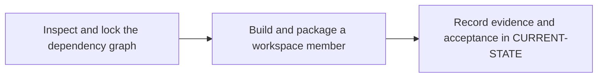

# P2 · Cargo builds and dependency management

**Prerequisites** — P1. **Effort** — 4–6 hours. **Access** — Local.

Compare Cargo.toml and Cargo.lock with the POM and Maven resolution. Study workspaces, features, profiles, targets, dependencies, registry configuration and crate packaging.

## Flow to trace

## Bounded implementation steps

### P2.1 · Inspect and lock the dependency graph

**Prerequisites** — Roadmap reviewed and phase dependencies met. Confirm access for the specific lab before starting.

**Scope and deliverable** — Perform the first exercise in the phase and save a reproducible lab note under [labs](../labs/README.md), including sanitized inputs and observed output.

**Verification and expected result** — Use cargo metadata --locked --format-version 1 and cargo tree -e features. Record the selected workspace members and feature path.

### P2.2 · Build and package a workspace member

**Prerequisites** — Complete P2.1 and confirm access for the second exercise.

**Scope and deliverable** — Perform the second exercise in isolation, then save the lab instructions, expected results, and a troubleshooting note for the demonstrated failure.

**Verification and expected result** — Run cargo test --workspace --locked, cargo build --release --locked and cargo package --list -p <crate>. Identify release binary and crate contents; rehearse an isolated packaging check before any publishing.

## Acceptance and operational review

Accept P2.1 when its verification is reproducible from the recorded inputs. Accept P2.2 when its verification is repeatable and the learner can meet this phase outcome.

Explain a stale lockfile error and distinguish the release executable from the crate package.

Use the phase's official references from [concepts](../concepts/README.md) and log each step separately in [CURRENT-STATE.md](../../CURRENT-STATE.md).

## Knowledge check

What does --locked enforce? What changes when features unify?
