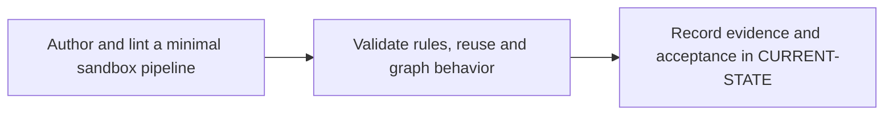

# P3 · GitLab CI YAML from zero

**Prerequisites** — P0. **Effort** — 5–8 hours. **Access** — GitLab.

Learn YAML mappings, sequences, quoting, indentation and block scalars. Separate include resolution, pipeline admission, job selection, graph construction and shell execution.

## Flow to trace

## Bounded implementation steps

### P3.1 · Author and lint a minimal sandbox pipeline

**Prerequisites** — Roadmap reviewed and phase dependencies met. Confirm access for the specific lab before starting.

**Scope and deliverable** — Perform the first exercise in the phase and save a reproducible lab note under [labs](../labs/README.md), including sanitized inputs and observed output.

**Verification and expected result** — Start with one script job, then add stages and a second job. CI Lint must accept both revisions; the graph must show stage ordering.

### P3.2 · Validate rules, reuse and graph behavior

**Prerequisites** — Complete P3.1 and confirm access for the second exercise.

**Scope and deliverable** — Perform the second exercise in isolation, then save the lab instructions, expected results, and a troubleshooting note for the demonstrated failure.

**Verification and expected result** — Add workflow rules, a pinned include and a reused job. Inspect merged YAML and exercise push, MR, schedule and manual pipeline cases in a sandbox; compare expected jobs and duplicate suppression.

## Acceptance and operational review

Accept P3.1 when its verification is reproducible from the recorded inputs. Accept P3.2 when its verification is repeatable and the learner can meet this phase outcome.

Explain why a YAML parser can accept a configuration that CI Lint rejects and why a lint simulation cannot cover every source.

Use the phase's official references from [concepts](../concepts/README.md) and log each step separately in [CURRENT-STATE.md](../../CURRENT-STATE.md).

## Knowledge check

What is the difference between workflow rules and job rules? When should an edge be optional?

## Keyword reference deliverable

Give each keyword a record with purpose, accepted syntax and scope, minimal example, enterprise example, common error, and a validation check. Use runnable examples after review, with a specific event/ref and expected job graph for each rules example.

- **P3.1 baseline** — job names, `stages`, `stage`, `script`, `before_script`, `after_script`, `default`, `image`, `services`, `tags`, `timeout` and `retry`. Verify that container settings are taught with a compatible executor.
- **P3.2 graph and reuse** — `workflow:rules`, job `rules` with `if`, `changes` and `exists`, `when`, `allow_failure`, `needs`, `parallel:matrix`, `include` forms, hidden jobs, `extends`, `inherit`, `spec:inputs` and `!reference`. Cover legacy `only/except` for reading existing files. Validate merged config and first-match behavior.
- **Follow-through in P4, P5 and P11** — `variables`, `environment`, `id_tokens`, `secrets`, `cache`, `artifacts`, `artifacts:reports`, `dependencies`, downstream `trigger`, `resource_group` and `interruptible`. Test protected/unprotected execution, missing artifacts, cancellation and release concurrency on the appropriate sandbox.

Source the records from the [GitLab YAML reference](https://docs.gitlab.com/ci/yaml/) and [CI Lint documentation](https://docs.gitlab.com/ci/yaml/lint/).
