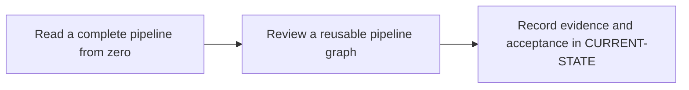

# P3 · GitLab CI YAML from zero

**Study effort** — 5–8 hours. **Access** — Offline documentation and configuration reading.

## Purpose and enterprise relevance

Learn YAML mappings, sequences, quoting, indentation and block scalars. Separate include resolution, pipeline admission, job selection, graph construction and shell execution.

Read the [concepts and definitions](../concepts/foundations.md#p3--gitlab-configuration-and-job-graphs) before the exercises.

**Operational target** — L3. Edit a rule or include and verify admitted and rejected events on paper. Diagnose a parser, merge, rule, dependency or shell failure from the smallest decisive evidence.

## Prerequisites

- **Mandatory** — P0. Use P0 to distinguish graph creation, assignment and shell execution.
- **Optional** — P4 for variable scopes and P5 for artifact details.
- Use the [concept index](../concepts/README.md) for source and version notes. Dependency checks concern the prerequisite knowledge listed here. A learner can use the existing material while earlier expansion work is pending.

## Layer A · Knowledge Base deliverables

**PLANNED chapter** — `docs/concepts/gitlab-config-model.md`

**Subject and learning objective** — GitLab configuration language and graph construction. Build a mental model that transfers across enterprise configurations and failure paths.

### Planned chapter hierarchy

1. **Concepts and definitions.** Teach YAML scalars, mappings, sequences, quoting and document boundaries first. Separate global, job and nested keyword scopes. Then cover includes, inputs, defaults, extends and references, followed by workflow, job rules, stages and needs. For each major concept, state why it exists, what problem it solves, what it owns and what it is commonly confused with.
2. **Responsibilities, relationships and usage.** Explain configuration reuse versus job inheritance, workflow admission versus job selection, and stage order versus DAG edges. Compare central templates with local configuration and document ownership and ref dependencies.
3. **Architecture and internal execution.** Plan a diagram from parse and include resolution through effective configuration, rule evaluation and edge validation. Cover denied events, omitted jobs, optional edges, matrix expansion and graph failures. Distinguish YAML validity, GitLab validation and runtime execution.
4. **Configuration and enterprise application.** Explain keyword defaults, merge and replacement behavior, rule expressions and expansion timing. Locate runner eligibility in GitLab settings and shell or executor choice in runner configuration. Explain compile-time versus runtime variables, reuse/merge semantics, duplicate pipelines, DAG scheduling and validation limits. Cross-reference P0 for runner execution.
5. **Selected illustrations.** Use a minimal config for YAML shape and a reusable config to illustrate merge and event variants. Choose only the variants needed to clarify the model. Present these after the relevant explanation and use Layer B for the full reference.
6. **Conclusions and knowledge checks.** Synthesize parse-time, pipeline-time and runtime decisions. Ask why correct syntax can yield the wrong graph or a failing command. Direct readers to P4 and P5.

**Dependencies and reuse** — Use the mandatory prerequisite knowledge above. Consult [P3 foundations](../concepts/foundations.md#p3--gitlab-configuration-and-job-graphs) for existing explanations, diagrams or later assessment alignment. Set chapter coverage from the hierarchy above and verify technical claims against authoritative references.

**Knowledge acceptance** — Explain the purpose, boundaries, interactions and material alternatives across the hierarchy. Diagrams and prose must agree for normal and significant alternate or failure paths. End with a synthesis that resolves the named distinctions and a knowledge check that can be answered from the chapter. Review completeness independently of any existing example or L1–L3 target. Plan roughly 1,000–2,000 words for substantial coverage, with room for diagrams and tables.

## Layer B · Practical Reference deliverables

**PLANNED reference** — `docs/references/gitlab-yaml-reference.md`.

- **Technologies and selected illustrations** — Line-by-line annotated complete single-file and reusable Windows and Linux examples with a push, MR, schedule and manual event matrix.
- **Syntax, alternatives and depth** — Cover the retained keyword checklist, defaults and errors. Show valid YAML that fails GitLab validation, a wrong graph and a shell-time error. Annotate material lines and explain defaults, tradeoffs, version assumptions and change consequences.
- **Dependencies and reuse** — Complete P3.A before choosing examples. Use existing material where it illustrates the established concepts: [1 · read a complete gitlab ci file](../labs/p3-1-read-a-complete-gitlab-ci-file.md), [2 · review a reusable pipeline graph](../labs/p3-2-review-a-reusable-pipeline-graph.md).
- **Acceptance** — Supply the configuration or evidence needed to predict the stated outcomes, identify owners and justify a safe alternative. Use complete illustrative files where appropriate, mark them unexecuted and check their structure offline.

## Layer C · Competency Validation deliverables

Apply the [L1–L3 model](../competency-levels/00-COMPETENCY-MODEL.md) and [validation rubric](../competency-levels/04-SUMMARY-VALIDATION.md). Each required level assumes Layers A and B and the knowledge and evidence listed below. Learners work through the required levels in order. The mapping below identifies evidence for selected capabilities already taught. Conceptual coverage may extend beyond the exercises and the initial competency target.

| Level | Expected capability and required knowledge | Exercise | Assessment evidence |
|---|---|---|---|
| L1 · Understand | Explain effective YAML, rules and expected graph for a chosen event. Requires the Layer A definitions and flow. | P3.1 keyword and YAML reading. | Annotated explanation citing the relevant configuration or trace and identifying the responsible component. |
| L2 · Modify | Edit a rule or include and verify admitted and rejected events on paper. Requires L1 and the Layer B syntax and ownership rules. | P3.2 rules and reusable graph review. | A bounded change or review decision with predicted outcomes, regression risk and applicable rollback. |
| L3 · Troubleshoot | Diagnose a parser, merge, rule, dependency or shell failure from the smallest decisive evidence Requires L2 and the Layer B failure evidence. | P3.1 configuration errors and P3.2 missing-edge cases. | A ranked hypothesis, decisive evidence, scoped correction and recovery check. |

**Exercise source** — Retain [1 · read a complete gitlab ci file](../labs/p3-1-read-a-complete-gitlab-ci-file.md), [2 · review a reusable pipeline graph](../labs/p3-2-review-a-reusable-pipeline-graph.md). Use the existing prompts and worked answers before adding any narrowly scoped extension.

## Educational gaps

- **EXISTING / ADEQUATE** for the stated baseline — Existing keyword cards and the seven-case event matrix support the baseline and reusable YAML walkthroughs. Evidence: [1 · read a complete gitlab ci file](../labs/p3-1-read-a-complete-gitlab-ci-file.md), [2 · review a reusable pipeline graph](../labs/p3-2-review-a-reusable-pipeline-graph.md).
- **EXISTING / NEEDS EXPANSION** for full phase coverage — Review [P3 foundations](../concepts/foundations.md#p3--gitlab-configuration-and-job-graphs) against Layer A. Unify the existing keyword cards into a systematic reference and expand configuration-evaluation theory.
- **MISSING / PLANNED** — The dedicated Layer A chapter and Layer B reference above. The existing lab pair needs a scored, explicit alignment review under P3.C.

## Implementation steps

### P3.A · Develop the Knowledge Base chapter

**Status** — PLANNED.

**Scope and inputs** — Develop the subject in the order specified by the Layer A hierarchy. Use prerequisite knowledge and technical references to establish scope, then consult existing material for reuse.

**Expected Markdown deliverable** — `docs/concepts/gitlab-config-model.md`.

**Dependencies** — Mandatory prerequisite knowledge above.

**Acceptance and documentation validation** — Meet Layer A acceptance. Trace each diagram through the prose, check normal and alternate paths against official references, and review the synthesis and knowledge checks independently of the labs.

### P3.B · Develop the Practical Reference

**Status** — PLANNED.

**Scope and inputs** — Select and annotate Layer B examples that clarify the completed subject model. Explain why each example is useful and what assumptions it makes.

**Expected Markdown deliverable** — `docs/references/gitlab-yaml-reference.md`.

**Dependencies** — P3.A.

**Acceptance and documentation validation** — Meet Layer B acceptance. Review annotated examples for syntax, compatible assumptions and deterministic expected outcomes; check Markdown links and file relationships.

### P3.1 · Read a complete pipeline from zero

**Status** — COMPLETED in the prior roadmap.

**Prerequisites** — Read the relevant prerequisite phase notes.

**Scope and deliverable** — Use the [complete GitLab CI reading exercise](../labs/p3-1-read-a-complete-gitlab-ci-file.md) to annotate YAML and core job keywords, then diagnose parser, configuration and execution errors.

**Verification** — Compare predictions with the official reference and verify that the worked answer follows from the supplied inputs.

**Educational dependencies** — For learners, read Layers A and B first. For historical inputs and deliverables, reuse the linked lab. P3.C checks its alignment.

**Existing Markdown input and deliverable** — [p3-1-read-a-complete-gitlab-ci-file.md](../labs/p3-1-read-a-complete-gitlab-ci-file.md).

**Acceptance and documentation validation** — Check the prompt against the stated evidence and expected answer in the corresponding Layer C capability. Verify references and version assumptions offline.

### P3.2 · Review a reusable pipeline graph

**Status** — COMPLETED in the prior roadmap.

**Prerequisites** — Complete P3.1.

**Scope and deliverable** — Use the [reusable pipeline graph exercise](../labs/p3-2-review-a-reusable-pipeline-graph.md) to resolve a typed include, compare event-specific job sets and diagnose missing edges.

**Verification** — Walk through the exercise offline and check the predicted outcome and diagnostic path against the example.

**Educational dependencies** — For learners, read Layers A and B first. For historical inputs and deliverables, reuse the linked lab. P3.C checks its alignment.

**Existing Markdown input and deliverable** — [p3-2-review-a-reusable-pipeline-graph.md](../labs/p3-2-review-a-reusable-pipeline-graph.md).

**Acceptance and documentation validation** — Check the prompt against the stated evidence and expected answer in the corresponding Layer C capability. Verify references and version assumptions offline.

### P3.C · Verify education coverage

**Status** — PLANNED.

**Scope and inputs** — Compare both layers and the retained P3.1/P3.2 deliverables with the Layer C table.

**Expected Markdown deliverable** — a coverage and scoring crosswalk in this phase specification, with any needed prompts or answer-key updates applied to the existing labs.

**Dependencies** — P3.A, P3.B, P3.1 and P3.2.

**Acceptance and documentation validation** — Walk through required assessments offline, verify each answer uses documented concepts and references, and close or explicitly classify gaps. Check links, fixture consistency and the phase status.

## Phase completion criteria

- **Knowledge complete** — P3.A meets its acceptance criteria, with definitions, component relationships and internal flows supported by diagrams.
- **Reference complete** — P3.B provides the stated enterprise scenario with annotated examples and tradeoffs.
- **Validation ready** — P3.C confirms that all required levels through L3 are assessable, including the existing or planned work in P3.1 and P3.2.
- **Education complete** — All three layers meet their criteria. Verify internal consistency from diagrams to settings, traces and answer keys. Judge conceptual breadth against the subject hierarchy and assess competency alignment separately. Phase-specific exit evidence: Explain why a YAML parser can accept a configuration that CI Lint rejects and why a lint simulation cannot cover every source.
- **Live validation deferred** — Runtime evidence is tracked separately in [Future labs](../../FUTURE-LABS.md). Historical step progress is in [CURRENT-STATE.md](../../CURRENT-STATE.md).

## Flow to trace

## Knowledge check

What is the difference between workflow rules and job rules? When should an edge be optional?

## Keyword reference deliverable

Give each keyword a record with purpose, accepted syntax and scope, minimal example, enterprise example, common error, and a validation check. Use complete unexecuted examples, with a specific event/ref and expected job graph for each rules example.

- **P3.1 baseline** — job names, `stages`, `stage`, `script`, `before_script`, `after_script`, `default`, `image`, `services`, `tags`, `timeout` and `retry`. Verify that container settings are taught with a compatible executor.
- **P3.2 graph and reuse** — `workflow:rules`, job `rules` with `if`, `changes` and `exists`, `when`, `allow_failure`, `needs`, `parallel:matrix`, `include` forms, hidden jobs, `extends`, `inherit`, `spec:inputs` and `!reference`. Cover legacy `only/except` for reading existing files. Validate merged config and first-match behavior.
- **Follow-through in P4, P5 and P11** — `variables`, `environment`, `id_tokens`, `secrets`, `cache`, `artifacts`, `artifacts:reports`, `dependencies`, downstream `trigger`, `resource_group` and `interruptible`. Use offline examples for protected and unprotected execution, missing artifacts, cancellation and release concurrency.

Source the records from the [GitLab YAML reference](https://docs.gitlab.com/ci/yaml/) and [CI Lint documentation](https://docs.gitlab.com/ci/yaml/lint/).
