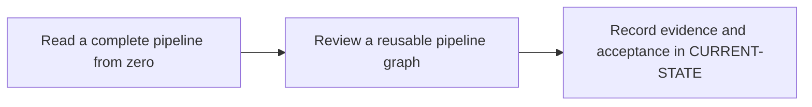

# P3 · GitLab CI YAML from zero

**Prerequisites** — P0. **Effort** — 5–8 hours. **Access** — Offline documentation and configuration reading.

Learn YAML mappings, sequences, quoting, indentation and block scalars. Separate include resolution, pipeline admission, job selection, graph construction and shell execution.

## Flow to trace

## Bounded documentation steps

### P3.1 · Read a complete pipeline from zero

**Prerequisites** — Read the relevant prerequisite phase notes.

**Scope and deliverable** — Annotate YAML and core job keywords, then diagnose parser and configuration errors. Save annotated examples and a worked answer.

**Verification** — Compare predictions with the official reference and verify that the worked answer follows from the supplied inputs.

### P3.2 · Review a reusable pipeline graph

**Prerequisites** — Complete P3.1.

**Scope and deliverable** — Manually resolve an include and compare push, MR, scheduled and manual job sets using a worked event matrix. Save a reading exercise, answer key and troubleshooting notes.

**Verification** — Walk through the exercise offline and check the predicted outcome and diagnostic path against the example.

## Acceptance and operational review

Mark this phase DOCUMENTATION COMPLETE when the explanations, annotated examples, troubleshooting guide and knowledge assessment are ready. Evaluate the following outcome by reading the supplied examples. [Future runtime lab](../../FUTURE-LABS.md).

Explain why a YAML parser can accept a configuration that CI Lint rejects and why a lint simulation cannot cover every source.

Use the phase's official references from [concepts](../concepts/README.md) and log each step separately in [CURRENT-STATE.md](../../CURRENT-STATE.md).

## Knowledge check

What is the difference between workflow rules and job rules? When should an edge be optional?

## Keyword reference deliverable

Give each keyword a record with purpose, accepted syntax and scope, minimal example, enterprise example, common error, and a validation check. Use complete unexecuted examples, with a specific event/ref and expected job graph for each rules example.

- **P3.1 baseline** — job names, `stages`, `stage`, `script`, `before_script`, `after_script`, `default`, `image`, `services`, `tags`, `timeout` and `retry`. Verify that container settings are taught with a compatible executor.
- **P3.2 graph and reuse** — `workflow:rules`, job `rules` with `if`, `changes` and `exists`, `when`, `allow_failure`, `needs`, `parallel:matrix`, `include` forms, hidden jobs, `extends`, `inherit`, `spec:inputs` and `!reference`. Cover legacy `only/except` for reading existing files. Validate merged config and first-match behavior.
- **Follow-through in P4, P5 and P11** — `variables`, `environment`, `id_tokens`, `secrets`, `cache`, `artifacts`, `artifacts:reports`, `dependencies`, downstream `trigger`, `resource_group` and `interruptible`. Use offline examples for protected and unprotected execution, missing artifacts, cancellation and release concurrency.

Source the records from the [GitLab YAML reference](https://docs.gitlab.com/ci/yaml/) and [CI Lint documentation](https://docs.gitlab.com/ci/yaml/lint/).
