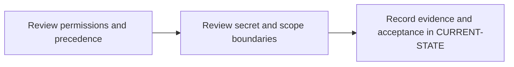

# P4 · Variables, roles and secret boundaries

**Study effort** — 3–5 hours. **Access** — Offline documentation and configuration reading.

## Purpose and enterprise relevance

Map group/project variables, scoped values, protected refs, expansion and least privilege. Compare CI runtime credentials with Maven settings and Spring property precedence.

Read the [concepts and definitions](../concepts/foundations.md#p4--variables-and-trust-boundaries) before the exercises.

**Operational target** — L3. Narrow scope or change an override without exposing another job to the value. Diagnose missing or wrong values, denied overrides and unexpected file paths without exposing secrets.

## Prerequisites

- **Mandatory** — P3. Use P3 to read job rules, environments and effective YAML.
- **Optional** — P6 for local Windows service ownership and file access.
- Use the [concept index](../concepts/README.md) for source and version notes. Dependency checks concern the prerequisite knowledge listed here. A learner can use the existing material while earlier expansion work is pending.

## Layer A · Knowledge Base deliverables

**PLANNED chapter** — `docs/concepts/gitlab-variable-model.md`

**Subject and learning objective** — GitLab variable lifecycle and authority. Build a mental model that transfers across enterprise configurations and failure paths.

### Planned chapter hierarchy

1. **Concepts and definitions.** Define variables, inputs and external secrets as distinct mechanisms. Teach source and scope before eligibility, precedence, type, visibility and expansion. Then cover ref protection, environment protection, caller roles and ownership. For each major concept, state why it exists, what problem it solves, what it owns and what it is commonly confused with.
2. **Responsibilities, relationships and usage.** Explain inheritance through instance, group and project, and the relationships among branch, environment, runner, job and protected resources. Compare file delivery, ordinary values and external retrieval for different consumers.
3. **Architecture and internal execution.** Plan an evaluation diagram from configuration-time availability to job selection, effective environment and shell. Include overrides, dotenv timing, temporary file cleanup, protected MR context and denied overrides. Distinguish confidentiality controls from log redaction.
4. **Configuration and enterprise application.** Locate access and ownership in GitLab UI and policy, job rules in YAML, environment injection at runtime and Windows service state outside YAML. Cover authorized input paths, version differences and safe evidence. Explain protected ref and MR conditions, precedence among eligible sources, shell delivery, role boundaries and why masking cannot stop a malicious job.
5. **Selected illustrations.** Select an override collision and a protected file-variable case. Use them to contrast precedence, eligibility and value delivery. Present these after the relevant explanation and use Layer B for the full reference.
6. **Conclusions and knowledge checks.** Synthesize visibility versus access, eligible versus winning, and compile-time versus runtime. Ask why a masked variable may still be exposed and why a valid value can be absent. Direct readers to P6 and P11.

**Dependencies and reuse** — Use the mandatory prerequisite knowledge above. Consult [P4 foundations](../concepts/foundations.md#p4--variables-and-trust-boundaries) for existing explanations, diagrams or later assessment alignment. Set chapter coverage from the hierarchy above and verify technical claims against authoritative references.

**Knowledge acceptance** — Explain the purpose, boundaries, interactions and material alternatives across the hierarchy. Diagrams and prose must agree for normal and significant alternate or failure paths. End with a synthesis that resolves the named distinctions and a knowledge check that can be answered from the chapter. Review completeness independently of any existing example or L1–L3 target. Plan roughly 1,000–2,000 words for substantial coverage, with room for diagrams and tables.

## Layer B · Practical Reference deliverables

**PLANNED reference** — `docs/references/gitlab-permissions-reference.md`.

- **Technologies and selected illustrations** — Annotated synthetic YAML, precedence matrix and project/group/runner settings navigation with read versus edit permission and version notes.
- **Syntax, alternatives and depth** — Explain scope and ref alternatives, variable overrides and safe boolean presence checks. Separate runner creation and protection permissions from variable editing. Annotate material lines and explain defaults, tradeoffs, version assumptions and change consequences.
- **Dependencies and reuse** — Complete P4.A before choosing examples. Use existing material where it illustrates the established concepts: [1 · review variable permissions and precedence](../labs/p4-1-review-variable-permissions-and-precedence.md), [2 · review secret and scope boundaries](../labs/p4-2-review-secret-and-scope-boundaries.md).
- **Acceptance** — Supply the configuration or evidence needed to predict the stated outcomes, identify owners and justify a safe alternative. Use complete illustrative files where appropriate, mark them unexecuted and check their structure offline.

## Layer C · Competency Validation deliverables

Apply the [L1–L3 model](../competency-levels/00-COMPETENCY-MODEL.md) and [validation rubric](../competency-levels/04-SUMMARY-VALIDATION.md). Each required level assumes Layers A and B and the knowledge and evidence listed below. Learners work through the required levels in order. The mapping below identifies evidence for selected capabilities already taught. Conceptual coverage may extend beyond the exercises and the initial competency target.

| Level | Expected capability and required knowledge | Exercise | Assessment evidence |
|---|---|---|---|
| L1 · Understand | Identify winning eligible source, effective type and settings owner. Requires the Layer A definitions and flow. | P4.1 precedence and permission review. | Annotated explanation citing the relevant configuration or trace and identifying the responsible component. |
| L2 · Modify | Narrow scope or change an override without exposing another job to the value. Requires L1 and the Layer B syntax and ownership rules. | P4.2 scope and settings change review. | A bounded change or review decision with predicted outcomes, regression risk and applicable rollback. |
| L3 · Troubleshoot | Diagnose missing or wrong values, denied overrides and unexpected file paths without exposing secrets Requires L2 and the Layer B failure evidence. | P4.1 override diagnosis and P4.2 missing secret cases. | A ranked hypothesis, decisive evidence, scoped correction and recovery check. |

**Exercise source** — Retain [1 · review variable permissions and precedence](../labs/p4-1-review-variable-permissions-and-precedence.md), [2 · review secret and scope boundaries](../labs/p4-2-review-secret-and-scope-boundaries.md). Use the existing prompts and worked answers before adding any narrowly scoped extension.

## Educational gaps

- **EXISTING / ADEQUATE** for the stated baseline — The precedence and access matrices support the existing synthetic settings scenarios. Evidence: [1 · review variable permissions and precedence](../labs/p4-1-review-variable-permissions-and-precedence.md), [2 · review secret and scope boundaries](../labs/p4-2-review-secret-and-scope-boundaries.md).
- **EXISTING / NEEDS EXPANSION** for full phase coverage — Review [P4 foundations](../concepts/foundations.md#p4--variables-and-trust-boundaries) against Layer A. Expand trust and evaluation architecture; add a version-qualified read/edit and runner settings access reference.
- **MISSING / PLANNED** — The dedicated Layer A chapter and Layer B reference above. The existing lab pair needs a scored, explicit alignment review under P4.C.

## Implementation steps

### P4.A · Develop the Knowledge Base chapter

**Status** — PLANNED.

**Scope and inputs** — Develop the subject in the order specified by the Layer A hierarchy. Use prerequisite knowledge and technical references to establish scope, then consult existing material for reuse.

**Expected Markdown deliverable** — `docs/concepts/gitlab-variable-model.md`.

**Dependencies** — Mandatory prerequisite knowledge above.

**Acceptance and documentation validation** — Meet Layer A acceptance. Trace each diagram through the prose, check normal and alternate paths against official references, and review the synthesis and knowledge checks independently of the labs.

### P4.B · Develop the Practical Reference

**Status** — PLANNED.

**Scope and inputs** — Select and annotate Layer B examples that clarify the completed subject model. Explain why each example is useful and what assumptions it makes.

**Expected Markdown deliverable** — `docs/references/gitlab-permissions-reference.md`.

**Dependencies** — P4.A.

**Acceptance and documentation validation** — Meet Layer B acceptance. Review annotated examples for syntax, compatible assumptions and deterministic expected outcomes; check Markdown links and file relationships.

### P4.1 · Review permissions and precedence

**Status** — COMPLETED in the prior roadmap.

**Prerequisites** — Read the relevant prerequisite phase notes.

**Scope and deliverable** — Use the [variable permissions and precedence exercise](../labs/p4-1-review-variable-permissions-and-precedence.md) to predict effective values and identify the owners of the relevant settings.

**Verification** — Compare predictions with the official reference and verify that the worked answer follows from the supplied inputs.

**Educational dependencies** — For learners, read Layers A and B first. For historical inputs and deliverables, reuse the linked lab. P4.C checks its alignment.

**Existing Markdown input and deliverable** — [p4-1-review-variable-permissions-and-precedence.md](../labs/p4-1-review-variable-permissions-and-precedence.md).

**Acceptance and documentation validation** — Check the prompt against the stated evidence and expected answer in the corresponding Layer C capability. Verify references and version assumptions offline.

### P4.2 · Review secret and scope boundaries

**Status** — COMPLETED in the prior roadmap.

**Prerequisites** — Complete P4.1.

**Scope and deliverable** — Use the [secret and scope exercise](../labs/p4-2-review-secret-and-scope-boundaries.md) to trace protected, environment-scoped and file-type variables, then diagnose missing inputs.

**Verification** — Walk through the exercise offline and check the predicted outcome and diagnostic path against the example.

**Educational dependencies** — For learners, read Layers A and B first. For historical inputs and deliverables, reuse the linked lab. P4.C checks its alignment.

**Existing Markdown input and deliverable** — [p4-2-review-secret-and-scope-boundaries.md](../labs/p4-2-review-secret-and-scope-boundaries.md).

**Acceptance and documentation validation** — Check the prompt against the stated evidence and expected answer in the corresponding Layer C capability. Verify references and version assumptions offline.

### P4.C · Verify education coverage

**Status** — PLANNED.

**Scope and inputs** — Compare both layers and the retained P4.1/P4.2 deliverables with the Layer C table.

**Expected Markdown deliverable** — a coverage and scoring crosswalk in this phase specification, with any needed prompts or answer-key updates applied to the existing labs.

**Dependencies** — P4.A, P4.B, P4.1 and P4.2.

**Acceptance and documentation validation** — Walk through required assessments offline, verify each answer uses documented concepts and references, and close or explicitly classify gaps. Check links, fixture consistency and the phase status.

## Phase completion criteria

- **Knowledge complete** — P4.A meets its acceptance criteria, with definitions, component relationships and internal flows supported by diagrams.
- **Reference complete** — P4.B provides the stated enterprise scenario with annotated examples and tradeoffs.
- **Validation ready** — P4.C confirms that all required levels through L3 are assessable, including the existing or planned work in P4.1 and P4.2.
- **Education complete** — All three layers meet their criteria. Verify internal consistency from diagrams to settings, traces and answer keys. Judge conceptual breadth against the subject hierarchy and assess competency alignment separately. Phase-specific exit evidence: Produce a precedence table and prove secret presence follows the intended trust boundary.
- **Live validation deferred** — Runtime evidence is tracked separately in [Future labs](../../FUTURE-LABS.md). Historical step progress is in [CURRENT-STATE.md](../../CURRENT-STATE.md).

## Flow to trace

## Knowledge check

Does masking stop an altered job from transmitting a credential? What does a file variable expand to?

## Permission and precedence checkpoints

Use **Settings → CI/CD → Variables** in the relevant project or group. Current GitLab documentation requires project Maintainer for project variables and group Owner for group variables. Record who can see each settings surface separately from who can edit values. Check the installed version's docs for custom roles, environment scoping and protected merge request behavior.

Start the collision lab with policy and supplied pipeline/manual values, then project, nearest group, instance, dotenv, YAML, deployment and predefined sources. Verify the full ordering and exceptions for the deployed version. Inputs are evaluated during configuration. Expansion can happen in GitLab, Runner or the shell, depending on the field. In PowerShell use `$env:NAME` for process variables.

Masking redacts supported log output, hiding limits UI retrieval, protection controls eligible refs and file variables expose a temporary file path. Use environment scope to narrow job exposure. Give each scanner its own scoped credential. Restrict pipeline overrides and code changes that can access privileged secrets. [GitLab CI/CD variables](https://docs.gitlab.com/ci/variables/)
