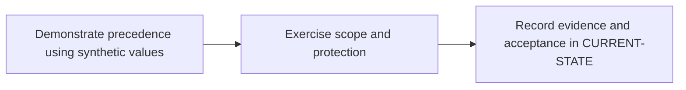

# P4 · Variables, roles and secret boundaries

**Prerequisites** — P3. **Effort** — 3–5 hours. **Access** — GitLab.

Map group/project variables, scoped values, protected refs, expansion and least privilege. Compare CI runtime credentials with Maven settings and Spring property precedence.

## Flow to trace

## Bounded implementation steps

### P4.1 · Demonstrate precedence using synthetic values

**Prerequisites** — Roadmap reviewed and phase dependencies met. Confirm access for the specific lab before starting.

**Scope and deliverable** — Perform the first exercise in the phase and save a reproducible lab note under [labs](../labs/README.md), including sanitized inputs and observed output.

**Verification and expected result** — Set the same harmless key in group, project and YAML, then optionally supply a pipeline value if authorized. Print only this key and compare the winner with the instance documentation.

### P4.2 · Exercise scope and protection

**Prerequisites** — Complete P4.1 and confirm access for the second exercise.

**Scope and deliverable** — Perform the second exercise in isolation, then save the lab instructions, expected results, and a troubleshooting note for the demonstrated failure.

**Verification and expected result** — Use dummy protected and file variables, a matching environment and two ref types. Log presence and type only, and record which roles can access each settings surface.

## Acceptance and operational review

Accept P4.1 when its verification is reproducible from the recorded inputs. Accept P4.2 when its verification is repeatable and the learner can meet this phase outcome.

Produce a precedence table and prove secret presence follows the intended trust boundary.

Use the phase's official references from [concepts](../concepts/README.md) and log each step separately in [CURRENT-STATE.md](../../CURRENT-STATE.md).

## Knowledge check

Does masking stop an altered job from transmitting a credential? What does a file variable expand to?

## Permission and precedence checkpoints

Use **Settings → CI/CD → Variables** in the relevant project or group. Current GitLab documentation requires project Maintainer for project variables and group Owner for group variables. Record who can see each settings surface separately from who can edit values. Check the installed version's docs for custom roles, environment scoping and protected merge request behavior.

Start the collision lab with policy and supplied pipeline/manual values, then project, nearest group, instance, dotenv, YAML, deployment and predefined sources. Verify the full ordering and exceptions for the deployed version. Inputs are evaluated during configuration. Expansion can happen in GitLab, Runner or the shell, depending on the field. In PowerShell use `$env:NAME` for process variables.

Masking redacts supported log output, hiding limits UI retrieval, protection controls eligible refs and file variables expose a temporary file path. Use environment scope to narrow job exposure. Give each scanner its own scoped credential. Restrict pipeline overrides and code changes that can access privileged secrets. [GitLab CI/CD variables](https://docs.gitlab.com/ci/variables/)
