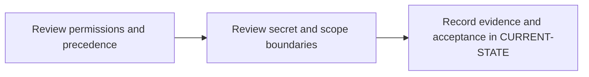

# P4 · Variables, roles and secret boundaries

**Prerequisites** — P3. **Effort** — 3–5 hours. **Access** — Offline documentation and configuration reading.

Map group/project variables, scoped values, protected refs, expansion and least privilege. Compare CI runtime credentials with Maven settings and Spring property precedence.

## Flow to trace

## Bounded documentation steps

### P4.1 · Review permissions and precedence

**Prerequisites** — Read the relevant prerequisite phase notes.

**Scope and deliverable** — Use the [variable permissions and precedence exercise](../labs/p4-1-review-variable-permissions-and-precedence.md) to predict effective values and identify the owners of the relevant settings.

**Verification** — Compare predictions with the official reference and verify that the worked answer follows from the supplied inputs.

### P4.2 · Review secret and scope boundaries

**Prerequisites** — Complete P4.1.

**Scope and deliverable** — Use the [secret and scope exercise](../labs/p4-2-review-secret-and-scope-boundaries.md) to trace protected, environment-scoped and file-type variables, then diagnose missing inputs.

**Verification** — Walk through the exercise offline and check the predicted outcome and diagnostic path against the example.

## Acceptance and operational review

**Status** — DOCUMENTATION COMPLETE. Both reading exercises include annotated configurations, troubleshooting and worked assessments. Implementation and runtime verification are DEFERRED. [Future runtime lab](../../FUTURE-LABS.md).

Produce a precedence table and prove secret presence follows the intended trust boundary.

Use the phase's official references from [concepts](../concepts/README.md) and log each step separately in [CURRENT-STATE.md](../../CURRENT-STATE.md).

## Knowledge check

Does masking stop an altered job from transmitting a credential? What does a file variable expand to?

## Permission and precedence checkpoints

Use **Settings → CI/CD → Variables** in the relevant project or group. Current GitLab documentation requires project Maintainer for project variables and group Owner for group variables. Record who can see each settings surface separately from who can edit values. Check the installed version's docs for custom roles, environment scoping and protected merge request behavior.

Start the collision lab with policy and supplied pipeline/manual values, then project, nearest group, instance, dotenv, YAML, deployment and predefined sources. Verify the full ordering and exceptions for the deployed version. Inputs are evaluated during configuration. Expansion can happen in GitLab, Runner or the shell, depending on the field. In PowerShell use `$env:NAME` for process variables.

Masking redacts supported log output, hiding limits UI retrieval, protection controls eligible refs and file variables expose a temporary file path. Use environment scope to narrow job exposure. Give each scanner its own scoped credential. Restrict pipeline overrides and code changes that can access privileged secrets. [GitLab CI/CD variables](https://docs.gitlab.com/ci/variables/)
