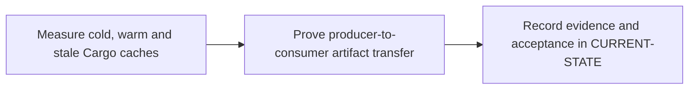

# P5 · Cache, artifacts and reuse

**Prerequisites** — P2, P3. **Effort** — 4–6 hours. **Access** — GitLab.

Compare dependency caches with the local Maven repository. Follow local and distributed cache paths, cache keys and policies, artifact retention, DAG transfer and downstream reuse.

## Flow to trace

## Bounded implementation steps

### P5.1 · Measure cold, warm and stale Cargo caches

**Prerequisites** — Roadmap reviewed and phase dependencies met. Confirm access for the specific lab before starting.

**Scope and deliverable** — Perform the first exercise in the phase and save a reproducible lab note under [labs](../labs/README.md), including sanitized inputs and observed output.

**Verification and expected result** — Run with a unique key, repeat on the same backend, then deliberately reuse a static key across a harmless fixture schema change. Record restore status and timings; key by lockfile and platform/toolchain to invalidate.

### P5.2 · Prove producer-to-consumer artifact transfer

**Prerequisites** — Complete P5.1 and confirm access for the second exercise.

**Scope and deliverable** — Perform the second exercise in isolation, then save the lab instructions, expected results, and a troubleshooting note for the demonstrated failure.

**Verification and expected result** — Pass a commit-stamped file through needs with artifacts enabled, then rehearse expired/missing artifacts. Plan parent-child or cross-project retrieval with provenance and tier checks.

## Acceptance and operational review

Accept P5.1 when its verification is reproducible from the recorded inputs. Accept P5.2 when its verification is repeatable and the learner can meet this phase outcome.

The consumer receives the expected commit marker even with an empty cache.

Use the phase's official references from [concepts](../concepts/README.md) and log each step separately in [CURRENT-STATE.md](../../CURRENT-STATE.md).

## Knowledge check

When can a cache hit still be stale? Which pipeline does needs:project select?
