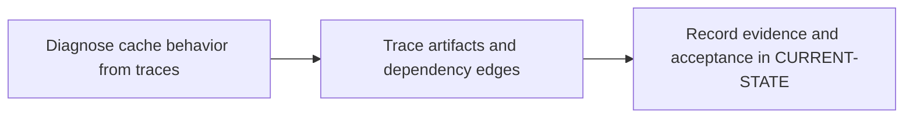

# P5 · Cache, artifacts and reuse

**Prerequisites** — P2, P3. **Effort** — 4–6 hours. **Access** — Offline documentation and configuration reading.

Compare dependency caches with the local Maven repository. Follow local and distributed cache paths, cache keys and policies, artifact retention, DAG transfer and downstream reuse.

Read the [concepts and definitions](../concepts/foundations.md#p5--cache-and-artifact-provenance) before the exercises.

## Flow to trace

## Bounded documentation steps

### P5.1 · Diagnose cache behavior from traces

**Prerequisites** — Read the relevant prerequisite phase notes.

**Scope and deliverable** — Use the [Cargo cache trace exercise](../labs/p5-1-diagnose-cargo-cache-behavior.md) to distinguish cold, warm and stale restores and review cache keys, paths and policies.

**Verification** — Compare predictions with the official reference and verify that the worked answer follows from the supplied inputs.

### P5.2 · Trace artifacts and dependency edges

**Prerequisites** — Complete P5.1.

**Scope and deliverable** — Use the [artifact transfer exercise](../labs/p5-2-trace-artifacts-and-dependency-edges.md) to identify provenance, retention and consumer behavior across pipeline boundaries.

**Verification** — Walk through the exercise offline and check the predicted outcome and diagnostic path against the example.

## Acceptance and operational review

**Status** — DOCUMENTATION COMPLETE. Both reading exercises include annotated configurations, troubleshooting and worked assessments. Implementation and runtime verification are DEFERRED. [Future runtime lab](../../FUTURE-LABS.md).

The consumer receives the expected commit marker even with an empty cache.

Use the phase's official references from [concepts](../concepts/README.md) and log each step separately in [CURRENT-STATE.md](../../CURRENT-STATE.md).

## Knowledge check

When can a cache hit still be stale? Which pipeline does needs:project select?
