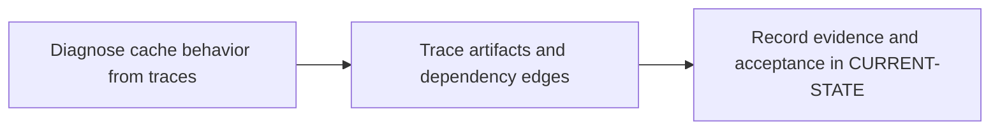

# P5 · Cache, artifacts and reuse

**Study effort** — 4–6 hours. **Access** — Offline documentation and configuration reading.

## Purpose and enterprise relevance

Compare dependency caches with the local Maven repository. Follow local and distributed cache paths, cache keys and policies, artifact retention, DAG transfer and downstream reuse.

Read the [concepts and definitions](../concepts/foundations.md#p5--cache-and-artifact-provenance) before the exercises.

**Operational target** — L3. Change key, policy or transfer edge and predict both cold and warm outcomes. Diagnose stale cache, backend miss, expired artifact and wrong producer using job/commit evidence.

## Prerequisites

- **Mandatory** — P2, P3. Use P2 for Cargo inputs and P3 for scheduling and dependency edges.
- **Optional** — P4 for trust and protected-ref context.
- Use the [concept index](../concepts/README.md) for source and version notes. Dependency checks concern the prerequisite knowledge listed here. A learner can use the existing material while earlier expansion work is pending.

## Layer A · Knowledge Base deliverables

**PLANNED chapter** — `docs/concepts/cache-artifact-model.md`

**Subject and learning objective** — CI workspace, cache and artifact model. Build a mental model that transfers across enterprise configurations and failure paths.

### Planned chapter hierarchy

1. **Concepts and definitions.** Define workspace persistence before reusable inputs, cache key and policy. Then define artifact, report, producer identity, transfer edge, access and retention. Separate job-local files, runner-local archives, distributed caches and artifact storage. For each major concept, state why it exists, what problem it solves, what it owns and what it is commonly confused with.
2. **Responsibilities, relationships and usage.** Explain when reuse is an optimization, when downstream work requires exact provenance, and the tradeoffs of writer policies, key specificity, isolation and retention. Compare registry caches with Maven dependency downloads.
3. **Architecture and internal execution.** Plan separate diagrams for cache restore/save and artifact upload/download. Cover missing and partial archives, same-key writers, expiration, access failures and same-pipeline, child and cross-project retrieval paths.
4. **Configuration and enterprise application.** Explain Cargo cache paths and credentials, key derivation and fallback, backend ownership, artifact transfer selection and trusted revision checks. Locate runner backend settings separately from YAML. Explain process/workspace reuse within jobs, cache isolation and invalidation, protected keys and races, and why a hit cannot identify a producer.
5. **Selected illustrations.** Use one cache trace and one exact-producer handoff. Select a ref-based counterexample to explain why a hit or a successful ref lookup does not establish provenance. Present these after the relevant explanation and use Layer B for the full reference.
6. **Conclusions and knowledge checks.** Synthesize key-based reuse versus producer-based identity. Ask whether a cold build remains correct and which metadata proves the source revision. Direct readers to P6 and P11.

**Dependencies and reuse** — Use the mandatory prerequisite knowledge above. Consult [P5 foundations](../concepts/foundations.md#p5--cache-and-artifact-provenance) for existing explanations, diagrams or later assessment alignment. Set chapter coverage from the hierarchy above and verify technical claims against authoritative references.

**Knowledge acceptance** — Explain the purpose, boundaries, interactions and material alternatives across the hierarchy. Diagrams and prose must agree for normal and significant alternate or failure paths. End with a synthesis that resolves the named distinctions and a knowledge check that can be answered from the chapter. Review completeness independently of any existing example or L1–L3 target. Plan roughly 1,000–2,000 words for substantial coverage, with room for diagrams and tables.

## Layer B · Practical Reference deliverables

**PLANNED reference** — `docs/references/cache-artifact-reference.md`.

- **Technologies and selected illustrations** — Annotated Cargo cache plus producer-consumer YAML, backend/topology comparison and retention and revision checklist.
- **Syntax, alternatives and depth** — Show pull/push behavior, Cargo paths, artifact access, needs and dependencies, and latest-successful versus exact job retrieval. Annotate material lines and explain defaults, tradeoffs, version assumptions and change consequences.
- **Dependencies and reuse** — Complete P5.A before choosing examples. Use existing material where it illustrates the established concepts: [1 · diagnose cargo cache behavior](../labs/p5-1-diagnose-cargo-cache-behavior.md), [2 · trace artifacts and dependency edges](../labs/p5-2-trace-artifacts-and-dependency-edges.md).
- **Acceptance** — Supply the configuration or evidence needed to predict the stated outcomes, identify owners and justify a safe alternative. Use complete illustrative files where appropriate, mark them unexecuted and check their structure offline.

## Layer C · Competency Validation deliverables

Apply the [L1–L3 model](../competency-levels/00-COMPETENCY-MODEL.md) and [validation rubric](../competency-levels/04-SUMMARY-VALIDATION.md). Each required level assumes Layers A and B and the knowledge and evidence listed below. Learners work through the required levels in order. The mapping below identifies evidence for selected capabilities already taught. Conceptual coverage may extend beyond the exercises and the initial competency target.

| Level | Expected capability and required knowledge | Exercise | Assessment evidence |
|---|---|---|---|
| L1 · Understand | Distinguish cache reuse from artifact provenance and trace file movement. Requires the Layer A definitions and flow. | P5.1 cache trace reading. | Annotated explanation citing the relevant configuration or trace and identifying the responsible component. |
| L2 · Modify | Change key, policy or transfer edge and predict both cold and warm outcomes. Requires L1 and the Layer B syntax and ownership rules. | P5.1 cache-policy change and P5.2 transfer-edge change. | A bounded change or review decision with predicted outcomes, regression risk and applicable rollback. |
| L3 · Troubleshoot | Diagnose stale cache, backend miss, expired artifact and wrong producer using job/commit evidence Requires L2 and the Layer B failure evidence. | P5.1 stale and locality traces and P5.2 provenance and retention cases. | A ranked hypothesis, decisive evidence, scoped correction and recovery check. |

**Exercise source** — Retain [1 · diagnose cargo cache behavior](../labs/p5-1-diagnose-cargo-cache-behavior.md), [2 · trace artifacts and dependency edges](../labs/p5-2-trace-artifacts-and-dependency-edges.md). Use the existing prompts and worked answers before adding any narrowly scoped extension.

## Educational gaps

- **EXISTING / ADEQUATE** for the stated baseline — The cache traces and artifact examples support reasoning about misses and known-producer handoffs. Evidence: [1 · diagnose cargo cache behavior](../labs/p5-1-diagnose-cargo-cache-behavior.md), [2 · trace artifacts and dependency edges](../labs/p5-2-trace-artifacts-and-dependency-edges.md).
- **EXISTING / NEEDS EXPANSION** for full phase coverage — Review [P5 foundations](../concepts/foundations.md#p5--cache-and-artifact-provenance) against Layer A. Expand storage lifecycle and tradeoffs and consolidate topology and invalidation decisions.
- **MISSING / PLANNED** — The dedicated Layer A chapter and Layer B reference above. The existing lab pair needs a scored, explicit alignment review under P5.C.

## Implementation steps

### P5.A · Develop the Knowledge Base chapter

**Status** — PLANNED.

**Scope and inputs** — Develop the subject in the order specified by the Layer A hierarchy. Use prerequisite knowledge and technical references to establish scope, then consult existing material for reuse.

**Expected Markdown deliverable** — `docs/concepts/cache-artifact-model.md`.

**Dependencies** — Mandatory prerequisite knowledge above.

**Acceptance and documentation validation** — Meet Layer A acceptance. Trace each diagram through the prose, check normal and alternate paths against official references, and review the synthesis and knowledge checks independently of the labs.

### P5.B · Develop the Practical Reference

**Status** — PLANNED.

**Scope and inputs** — Select and annotate Layer B examples that clarify the completed subject model. Explain why each example is useful and what assumptions it makes.

**Expected Markdown deliverable** — `docs/references/cache-artifact-reference.md`.

**Dependencies** — P5.A.

**Acceptance and documentation validation** — Meet Layer B acceptance. Review annotated examples for syntax, compatible assumptions and deterministic expected outcomes; check Markdown links and file relationships.

### P5.1 · Diagnose cache behavior from traces

**Status** — COMPLETED in the prior roadmap.

**Prerequisites** — Read the relevant prerequisite phase notes.

**Scope and deliverable** — Use the [Cargo cache trace exercise](../labs/p5-1-diagnose-cargo-cache-behavior.md) to distinguish cold, warm and stale restores and review cache keys, paths and policies.

**Verification** — Compare predictions with the official reference and verify that the worked answer follows from the supplied inputs.

**Educational dependencies** — For learners, read Layers A and B first. For historical inputs and deliverables, reuse the linked lab. P5.C checks its alignment.

**Existing Markdown input and deliverable** — [p5-1-diagnose-cargo-cache-behavior.md](../labs/p5-1-diagnose-cargo-cache-behavior.md).

**Acceptance and documentation validation** — Check the prompt against the stated evidence and expected answer in the corresponding Layer C capability. Verify references and version assumptions offline.

### P5.2 · Trace artifacts and dependency edges

**Status** — COMPLETED in the prior roadmap.

**Prerequisites** — Complete P5.1.

**Scope and deliverable** — Use the [artifact transfer exercise](../labs/p5-2-trace-artifacts-and-dependency-edges.md) to identify provenance, retention and consumer behavior across pipeline boundaries.

**Verification** — Walk through the exercise offline and check the predicted outcome and diagnostic path against the example.

**Educational dependencies** — For learners, read Layers A and B first. For historical inputs and deliverables, reuse the linked lab. P5.C checks its alignment.

**Existing Markdown input and deliverable** — [p5-2-trace-artifacts-and-dependency-edges.md](../labs/p5-2-trace-artifacts-and-dependency-edges.md).

**Acceptance and documentation validation** — Check the prompt against the stated evidence and expected answer in the corresponding Layer C capability. Verify references and version assumptions offline.

### P5.C · Verify education coverage

**Status** — PLANNED.

**Scope and inputs** — Compare both layers and the retained P5.1/P5.2 deliverables with the Layer C table.

**Expected Markdown deliverable** — a coverage and scoring crosswalk in this phase specification, with any needed prompts or answer-key updates applied to the existing labs.

**Dependencies** — P5.A, P5.B, P5.1 and P5.2.

**Acceptance and documentation validation** — Walk through required assessments offline, verify each answer uses documented concepts and references, and close or explicitly classify gaps. Check links, fixture consistency and the phase status.

## Phase completion criteria

- **Knowledge complete** — P5.A meets its acceptance criteria, with definitions, component relationships and internal flows supported by diagrams.
- **Reference complete** — P5.B provides the stated enterprise scenario with annotated examples and tradeoffs.
- **Validation ready** — P5.C confirms that all required levels through L3 are assessable, including the existing or planned work in P5.1 and P5.2.
- **Education complete** — All three layers meet their criteria. Verify internal consistency from diagrams to settings, traces and answer keys. Judge conceptual breadth against the subject hierarchy and assess competency alignment separately. Phase-specific exit evidence: The consumer receives the expected commit marker even with an empty cache.
- **Live validation deferred** — Runtime evidence is tracked separately in [Future labs](../../FUTURE-LABS.md). Historical step progress is in [CURRENT-STATE.md](../../CURRENT-STATE.md).

## Flow to trace

## Knowledge check

When can a cache hit still be stale? Which pipeline does needs:project select?
