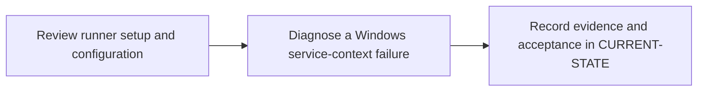

# P6 · Windows Shell runner

**Prerequisites** — P3, P4. **Effort** — 6–9 hours. **Access** — Offline documentation and configuration reading.

Map GitLab runner scope and registration to Windows service identity, host ACLs, runtime and shell. Compare shared-host execution with Linux containers.

Read the [Windows Shell Runner concept guide](../concepts/windows-shell-runner.md) before the exercises.

## Flow to trace

## Bounded documentation steps

### P6.1 · Review runner setup and configuration

**Prerequisites** — Read the relevant prerequisite phase notes.

**Scope and deliverable** — Use the [Windows runner setup exercise](../labs/p6-1-review-windows-runner-setup.md) to review registration, service identity, scope, tags and TOML settings.

**Verification** — Compare predictions with the official reference and verify that the worked answer follows from the supplied inputs.

### P6.2 · Diagnose a Windows service-context failure

**Prerequisites** — Complete P6.1.

**Scope and deliverable** — Use the [service-context exercise](../labs/p6-2-diagnose-windows-service-context.md) to diagnose PowerShell, path, native exit, TLS and tool lookup failures.

**Verification** — Walk through the exercise offline and check the predicted outcome and diagnostic path against the example.

## Acceptance and operational review

**Status** — DOCUMENTATION COMPLETE. The concept guide and both reading exercises include diagrams, annotated examples, troubleshooting and worked assessments. Implementation and runtime verification are DEFERRED. [Future runtime lab](../../FUTURE-LABS.md).

Record account, explicit shell, matching tags, toolchain, protected-ref behavior and the isolation decision.

Use the phase's official references from [concepts](../concepts/README.md) and log each step separately in [CURRENT-STATE.md](../../CURRENT-STATE.md).

## Knowledge check

Why can cargo work in a console but fail in CI? What does runner verify prove?

## Host and registration checkpoints

- Separate GitLab authorization from host authorization. Project runner creation requires project Maintainer. Check the target release and UI/API path for group creation requirements. Instance runner creation is an administrator operation on self-managed GitLab. Project runners serve assigned projects, group runners are inherited within a group and instance runners are available instance-wide subject to settings. [Runner scopes](https://docs.gitlab.com/ci/runners/runners_scope/)
- Plan elevated setup on a dedicated VM. Restrict writes to the executable and service configuration. Grant the service identity Log on as a service and access to build/cache directories and approved tools. Validate Git, PowerShell, Rust MSVC tools and scanner binaries in the service context. [Windows installation](https://docs.gitlab.com/runner/install/windows/)
- In the runner lab, document the active `config.toml` path and verify explicit `executor = "shell"` and `shell = "pwsh"`. Compare `powershell` (Windows PowerShell) with `pwsh` (PowerShell Core). Cover `builds_dir`, `cache_dir`, global `concurrent` and per-runner `limit`. Use low concurrency initially and separate VMs for different trust levels. [Advanced configuration](https://docs.gitlab.com/runner/configuration/advanced-configuration/)
- Match every job tag and test protected-ref eligibility. Teach quoted paths and `Join-Path`, explicit exit handling for native commands, and consistent line endings. Check proxy and CA trust separately for GitLab Runner, Git, Cargo and each scanner. Shell jobs use host binaries and share the Windows host under the service identity. [Shell executor](https://docs.gitlab.com/runner/executors/shell/)
