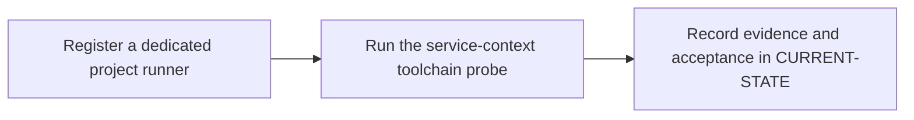

# P6 · Windows Shell runner

**Prerequisites** — P3, P4. **Effort** — 6–9 hours. **Access** — GitLab + Windows.

Map GitLab runner scope and registration to Windows service identity, host ACLs, runtime and shell. Compare shared-host execution with Linux containers.

## Flow to trace

## Bounded implementation steps

### P6.1 · Register a dedicated project runner

**Prerequisites** — Roadmap reviewed and phase dependencies met. Confirm access for the specific lab before starting.

**Scope and deliverable** — Perform the first exercise in the phase and save a reproducible lab note under [labs](../labs/README.md), including sanitized inputs and observed output.

**Verification and expected result** — Create it with a runner authentication token; register on the VM using the shell executor. Install/start the service, then verify connectivity, service state and server-side eligibility.

### P6.2 · Run the service-context toolchain probe

**Prerequisites** — Complete P6.1 and confirm access for the second exercise.

**Scope and deliverable** — Perform the second exercise in isolation, then save the lab instructions, expected results, and a troubleshooting note for the demonstrated failure.

**Verification and expected result** — Use a tagged job to check whoami, Get-Command git,cargo,rustc,pwsh and rustc -vV. Reproduce a missing service PATH entry, fix the service environment and rerun. Verify a native compile.

## Acceptance and operational review

Accept P6.1 when its verification is reproducible from the recorded inputs. Accept P6.2 when its verification is repeatable and the learner can meet this phase outcome.

Record account, explicit shell, matching tags, toolchain, protected-ref behavior and the isolation decision.

Use the phase's official references from [concepts](../concepts/README.md) and log each step separately in [CURRENT-STATE.md](../../CURRENT-STATE.md).

## Knowledge check

Why can cargo work in a console but fail in CI? What does runner verify prove?

## Host and registration checkpoints

- Separate GitLab authorization from host authorization. Project runner creation requires project Maintainer. Check the target release and UI/API path for group creation requirements. Instance runner creation is an administrator operation on self-managed GitLab. Project runners serve assigned projects, group runners are inherited within a group and instance runners are available instance-wide subject to settings. [Runner scopes](https://docs.gitlab.com/ci/runners/runners_scope/)
- Plan elevated setup on a dedicated VM. Restrict writes to the executable and service configuration. Grant the service identity Log on as a service and access to build/cache directories and approved tools. Validate Git, PowerShell, Rust MSVC tools and scanner binaries in the service context. [Windows installation](https://docs.gitlab.com/runner/install/windows/)
- In the runner lab, document the active `config.toml` path and verify explicit `executor = "shell"` and `shell = "pwsh"`. Compare `powershell` (Windows PowerShell) with `pwsh` (PowerShell Core). Cover `builds_dir`, `cache_dir`, global `concurrent` and per-runner `limit`. Use low concurrency initially and separate VMs for different trust levels. [Advanced configuration](https://docs.gitlab.com/runner/configuration/advanced-configuration/)
- Match every job tag and test protected-ref eligibility. Teach quoted paths and `Join-Path`, explicit exit handling for native commands, and consistent line endings. Check proxy and CA trust separately for GitLab Runner, Git, Cargo and each scanner. Shell jobs use host binaries and share the Windows host under the service identity. [Shell executor](https://docs.gitlab.com/runner/executors/shell/)
