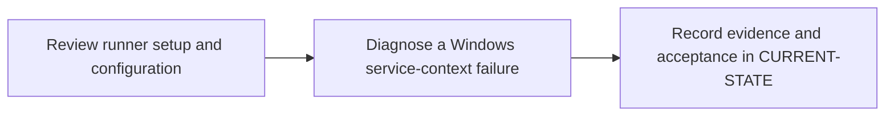

# P6 · Windows Shell runner

**Study effort** — 6–9 hours. **Access** — Offline documentation and configuration reading.

## Purpose and enterprise relevance

Map GitLab runner scope and registration to Windows service identity, host ACLs, runtime and shell. Compare shared-host execution with Linux containers.

Read the [Windows Shell Runner concept guide](../concepts/windows-shell-runner.md) before the exercises.

**Operational target** — L3. Propose a routing, shell or service configuration change with security and rollback consequences. Distinguish pending assignment, PATH/linker failures, client TLS failures and stale output collection.

## Prerequisites

- **Mandatory** — P3, P4. Use P3 for job routing and P4 for variable eligibility and protected refs.
- **Optional** — P5 for storage and artifact details; P2 for the Cargo toolchain model.
- Use the [concept index](../concepts/README.md) for source and version notes. Dependency checks concern the prerequisite knowledge listed here. A learner can use the existing material while earlier expansion work is pending.

## Layer A · Knowledge Base deliverables

**PLANNED chapter** — `docs/concepts/windows-runner-architecture.md`

**Subject and learning objective** — Windows runner host, service and execution architecture. Build a mental model that transfers across enterprise configurations and failure paths.

### Planned chapter hierarchy

1. **Concepts and definitions.** Define server-side runner record and scope before manager registration and authentication. Then separate Windows service identity, executor, PowerShell process, workspace, toolchain, cache backend and artifact storage by lifetime and ownership. For each major concept, state why it exists, what problem it solves, what it owns and what it is commonly confused with.
2. **Responsibilities, relationships and usage.** Explain project/group/instance scope, matching and protection, registration versus service startup, Shell versus container isolation, and service account versus interactive account. Connect ACLs, concurrency and host image choices to enterprise trust.
3. **Architecture and internal execution.** Plan component and lifecycle diagrams covering service startup, polling, assignment, checkout, transfer, native execution and result. Include stopped service, pending job, missing tool, linker failure and separate TLS/proxy boundaries. Separate documented contracts from Windows, Runner and shell version behavior.
4. **Configuration and enterprise application.** Map settings to GitLab UI, config.toml, job YAML and Windows. Explain runner credentials, build/cache paths, PowerShell selection, service PATH, MSVC and CA trust before showing commands. Explain job identity, ACLs, host isolation, concurrency, PATH and MSVC, native exit status, registry/proxy/TLS boundaries and runner-side versus YAML responsibilities.
5. **Selected illustrations.** Select a protected routing example and service-context trace to illustrate the model. Use additional isolated snippets for path quoting or exit handling only as needed. Present these after the relevant explanation and use Layer B for the full reference.
6. **Conclusions and knowledge checks.** Synthesize registration, availability, eligibility and execution as separate checks. Ask what a healthy service or connectivity probe establishes about each. Direct readers to P2, P5 and P12.

**Dependencies and reuse** — Use the mandatory prerequisite knowledge above. Consult [Windows Shell Runner guide](../concepts/windows-shell-runner.md) and [shared execution architecture](../architecture/README.md) for existing explanations, diagrams or later assessment alignment. Set chapter coverage from the hierarchy above and verify technical claims against authoritative references.

**Knowledge acceptance** — Explain the purpose, boundaries, interactions and material alternatives across the hierarchy. Diagrams and prose must agree for normal and significant alternate or failure paths. End with a synthesis that resolves the named distinctions and a knowledge check that can be answered from the chapter. Review completeness independently of any existing example or L1–L3 target. Plan roughly 1,000–2,000 words for substantial coverage, with room for diagrams and tables.

## Layer B · Practical Reference deliverables

**PLANNED reference** — `docs/references/windows-runner-reference.md`.

- **Technologies and selected illustrations** — Annotated config.toml, service/registration commands, GitLab UI settings and PowerShell probe with paths and exit guards.
- **Syntax, alternatives and depth** — Cover tags, protection, token handling, service identity, build/cache directories, shell selection and review checks; compare Shell and container tradeoffs. Annotate material lines and explain defaults, tradeoffs, version assumptions and change consequences.
- **Dependencies and reuse** — Complete P6.A before choosing examples. Use existing material where it illustrates the established concepts: [1 · review windows runner setup](../labs/p6-1-review-windows-runner-setup.md), [2 · diagnose windows service context](../labs/p6-2-diagnose-windows-service-context.md).
- **Acceptance** — Supply the configuration or evidence needed to predict the stated outcomes, identify owners and justify a safe alternative. Use complete illustrative files where appropriate, mark them unexecuted and check their structure offline.

## Layer C · Competency Validation deliverables

Apply the [L1–L3 model](../competency-levels/00-COMPETENCY-MODEL.md) and [validation rubric](../competency-levels/04-SUMMARY-VALIDATION.md). Each required level assumes Layers A and B and the knowledge and evidence listed below. Learners work through the required levels in order. The mapping below identifies evidence for selected capabilities already taught. Conceptual coverage may extend beyond the exercises and the initial competency target.

| Level | Expected capability and required knowledge | Exercise | Assessment evidence |
|---|---|---|---|
| L1 · Understand | Trace an assigned job to the service account, shell and workspace. Requires the Layer A definitions and flow. | P6.1 runner record, TOML and job trace review. | Annotated explanation citing the relevant configuration or trace and identifying the responsible component. |
| L2 · Modify | Propose a routing, shell or service configuration change with security and rollback consequences. Requires L1 and the Layer B syntax and ownership rules. | P6.1 runner routing review and the shared L2 Windows change. | A bounded change or review decision with predicted outcomes, regression risk and applicable rollback. |
| L3 · Troubleshoot | Distinguish pending assignment, PATH/linker failures, client TLS failures and stale output collection Requires L2 and the Layer B failure evidence. | P6.2 service-context failure cases. | A ranked hypothesis, decisive evidence, scoped correction and recovery check. |

**Exercise source** — Retain [1 · review windows runner setup](../labs/p6-1-review-windows-runner-setup.md), [2 · diagnose windows service context](../labs/p6-2-diagnose-windows-service-context.md). Use the existing prompts and worked answers before adding any narrowly scoped extension.

## Educational gaps

- **EXISTING / ADEQUATE** for the stated baseline — The Windows setup and diagnosis labs demonstrate routing, TOML, service identity, TLS and tool lookup. Evidence: [1 · review windows runner setup](../labs/p6-1-review-windows-runner-setup.md), [2 · diagnose windows service context](../labs/p6-2-diagnose-windows-service-context.md).
- **EXISTING / NEEDS EXPANSION** for full phase coverage — Review [Windows Shell Runner guide](../concepts/windows-shell-runner.md) and [shared execution architecture](../architecture/README.md) against Layer A. Extend the guide into a complete lifecycle view including storage; consolidate setup, ownership and service-versus-job settings.
- **MISSING / PLANNED** — The dedicated Layer A chapter and Layer B reference above. The existing lab pair needs a scored, explicit alignment review under P6.C.

## Implementation steps

### P6.A · Develop the Knowledge Base chapter

**Status** — PLANNED.

**Scope and inputs** — Develop the subject in the order specified by the Layer A hierarchy. Use prerequisite knowledge and technical references to establish scope, then consult existing material for reuse.

**Expected Markdown deliverable** — `docs/concepts/windows-runner-architecture.md`.

**Dependencies** — Mandatory prerequisite knowledge above.

**Acceptance and documentation validation** — Meet Layer A acceptance. Trace each diagram through the prose, check normal and alternate paths against official references, and review the synthesis and knowledge checks independently of the labs.

### P6.B · Develop the Practical Reference

**Status** — PLANNED.

**Scope and inputs** — Select and annotate Layer B examples that clarify the completed subject model. Explain why each example is useful and what assumptions it makes.

**Expected Markdown deliverable** — `docs/references/windows-runner-reference.md`.

**Dependencies** — P6.A.

**Acceptance and documentation validation** — Meet Layer B acceptance. Review annotated examples for syntax, compatible assumptions and deterministic expected outcomes; check Markdown links and file relationships.

### P6.1 · Review runner setup and configuration

**Status** — COMPLETED in the prior roadmap.

**Prerequisites** — Read the relevant prerequisite phase notes.

**Scope and deliverable** — Use the [Windows runner setup exercise](../labs/p6-1-review-windows-runner-setup.md) to review registration, service identity, scope, tags and TOML settings.

**Verification** — Compare predictions with the official reference and verify that the worked answer follows from the supplied inputs.

**Educational dependencies** — For learners, read Layers A and B first. For historical inputs and deliverables, reuse the linked lab. P6.C checks its alignment.

**Existing Markdown input and deliverable** — [p6-1-review-windows-runner-setup.md](../labs/p6-1-review-windows-runner-setup.md).

**Acceptance and documentation validation** — Check the prompt against the stated evidence and expected answer in the corresponding Layer C capability. Verify references and version assumptions offline.

### P6.2 · Diagnose a Windows service-context failure

**Status** — COMPLETED in the prior roadmap.

**Prerequisites** — Complete P6.1.

**Scope and deliverable** — Use the [service-context exercise](../labs/p6-2-diagnose-windows-service-context.md) to diagnose PowerShell, path, native exit, TLS and tool lookup failures.

**Verification** — Walk through the exercise offline and check the predicted outcome and diagnostic path against the example.

**Educational dependencies** — For learners, read Layers A and B first. For historical inputs and deliverables, reuse the linked lab. P6.C checks its alignment.

**Existing Markdown input and deliverable** — [p6-2-diagnose-windows-service-context.md](../labs/p6-2-diagnose-windows-service-context.md).

**Acceptance and documentation validation** — Check the prompt against the stated evidence and expected answer in the corresponding Layer C capability. Verify references and version assumptions offline.

### P6.C · Verify education coverage

**Status** — PLANNED.

**Scope and inputs** — Compare both layers and the retained P6.1/P6.2 deliverables with the Layer C table.

**Expected Markdown deliverable** — a coverage and scoring crosswalk in this phase specification, with any needed prompts or answer-key updates applied to the existing labs.

**Dependencies** — P6.A, P6.B, P6.1 and P6.2.

**Acceptance and documentation validation** — Walk through required assessments offline, verify each answer uses documented concepts and references, and close or explicitly classify gaps. Check links, fixture consistency and the phase status.

## Phase completion criteria

- **Knowledge complete** — P6.A meets its acceptance criteria, with definitions, component relationships and internal flows supported by diagrams.
- **Reference complete** — P6.B provides the stated enterprise scenario with annotated examples and tradeoffs.
- **Validation ready** — P6.C confirms that all required levels through L3 are assessable, including the existing or planned work in P6.1 and P6.2.
- **Education complete** — All three layers meet their criteria. Verify internal consistency from diagrams to settings, traces and answer keys. Judge conceptual breadth against the subject hierarchy and assess competency alignment separately. Phase-specific exit evidence: Record account, explicit shell, matching tags, toolchain, protected-ref behavior and the isolation decision.
- **Live validation deferred** — Runtime evidence is tracked separately in [Future labs](../../FUTURE-LABS.md). Historical step progress is in [CURRENT-STATE.md](../../CURRENT-STATE.md).

## Flow to trace

## Knowledge check

Why can cargo work in a console but fail in CI? What does runner verify prove?

## Host and registration checkpoints

- Separate GitLab authorization from host authorization. Project runner creation requires project Maintainer. Check the target release and UI/API path for group creation requirements. Instance runner creation is an administrator operation on self-managed GitLab. Project runners serve assigned projects, group runners are inherited within a group and instance runners are available instance-wide subject to settings. [Runner scopes](https://docs.gitlab.com/ci/runners/runners_scope/)
- Plan elevated setup on a dedicated VM. Restrict writes to the executable and service configuration. Grant the service identity Log on as a service and access to build/cache directories and approved tools. Validate Git, PowerShell, Rust MSVC tools and scanner binaries in the service context. [Windows installation](https://docs.gitlab.com/runner/install/windows/)
- In the runner lab, document the active `config.toml` path and verify explicit `executor = "shell"` and `shell = "pwsh"`. Compare `powershell` (Windows PowerShell) with `pwsh` (PowerShell Core). Cover `builds_dir`, `cache_dir`, global `concurrent` and per-runner `limit`. Use low concurrency initially and separate VMs for different trust levels. [Advanced configuration](https://docs.gitlab.com/runner/configuration/advanced-configuration/)
- Match every job tag and test protected-ref eligibility. Teach quoted paths and `Join-Path`, explicit exit handling for native commands, and consistent line endings. Check proxy and CA trust separately for GitLab Runner, Git, Cargo and each scanner. Shell jobs use host binaries and share the Windows host under the service identity. [Shell executor](https://docs.gitlab.com/runner/executors/shell/)
