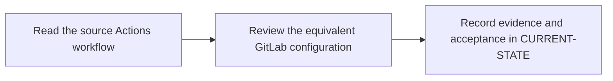

# P7 · GitHub Actions migration

**Prerequisites** — P5, P6. **Effort** — 4–6 hours. **Access** — Offline documentation and configuration reading.

Translate workflows, events, jobs and steps, runners, expressions, env/secrets, reusable workflows, caches and artifact transfers. Preserve event and credential semantics.

## Flow to trace

## Bounded documentation steps

### P7.1 · Read the source Actions workflow

**Prerequisites** — Read the relevant prerequisite phase notes.

**Scope and deliverable** — Map triggers, runners, permissions, reusable workflows, caching and artifacts. Save annotated examples and a worked answer.

**Verification** — Compare predictions with the official reference and verify that the worked answer follows from the supplied inputs.

### P7.2 · Review the equivalent GitLab configuration

**Prerequisites** — Complete P7.1.

**Scope and deliverable** — Compare complete workflows and predict event parity, fork behavior and output differences. Save a reading exercise, answer key and troubleshooting notes.

**Verification** — Walk through the exercise offline and check the predicted outcome and diagnostic path against the example.

## Acceptance and operational review

Mark this phase DOCUMENTATION COMPLETE when the explanations, annotated examples, troubleshooting guide and knowledge assessment are ready. Evaluate the following outcome by reading the supplied examples. [Future runtime lab](../../FUTURE-LABS.md).

Account for each event, shell, permission and artifact difference with observed or explicitly unavailable evidence.

Use the phase's official references from [concepts](../concepts/README.md) and log each step separately in [CURRENT-STATE.md](../../CURRENT-STATE.md).

## Knowledge check

Which Actions steps need explicit GitLab commands? Where can fork secret exposure differ?
