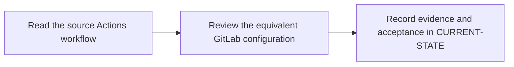

# P7 · GitHub Actions migration

**Study effort** — 4–6 hours. **Access** — Offline documentation and configuration reading.

## Purpose and enterprise relevance

Translate workflows, events, jobs and steps, runners, expressions, env/secrets, reusable workflows, caches and artifact transfers. Preserve event and credential semantics.

**Operational target** — L2. Translate the workflow and justify each parity decision for the listed events. Diagnose a parity drift using the same fixture. Full platform incident response is a later target.

## Prerequisites

- **Mandatory** — P5, P6. Use P5 for data handoffs and P6 for runner and shell behavior.
- **Optional** — P4 for extra review of credentials and trust boundaries.
- Use the [concept index](../concepts/README.md) for source and version notes. Dependency checks concern the prerequisite knowledge listed here. A learner can use the existing material while earlier expansion work is pending.

## Layer A · Knowledge Base deliverables

**PLANNED chapter** — `docs/concepts/actions-migration-model.md`

**Subject and learning objective** — Workflow migration semantics. Build a mental model that transfers across enterprise configurations and failure paths.

### Planned chapter hierarchy

1. **Concepts and definitions.** Define Actions workflow, event, job, step, action, runner, contexts, reusable workflow and permissions. Map each to the comparable GitLab concepts after defining the individual platforms' boundaries. For each major concept, state why it exists, what problem it solves, what it owns and what it is commonly confused with.
2. **Responsibilities, relationships and usage.** Explain where step reuse differs from job or pipeline reuse, event/filter semantics, hosted versus managed runners, token and fork trust models and the tradeoff between parity and deliberate redesign.
3. **Architecture and internal execution.** Plan paired graphs and sequences for event admission, runner dispatch, shell execution, cache and artifact transfer. Include push/PR/MR, forks, schedules, manual dispatch and incompatible or unsupported behaviors.
4. **Configuration and enterprise application.** Compare workflow triggers, GitLab rules, runners, permission and secret settings, shell invocation, dependencies and data transfer before translation. Explain event parity, runner and shell differences, token scope, evaluation timing and why a mechanical keyword translation fails.
5. **Selected illustrations.** Select a before/after workflow that illuminates parity. Use the existing protected quality-job excerpt as an optional supplemental example. Present these after the relevant explanation and use Layer B for the full reference.
6. **Conclusions and knowledge checks.** Synthesize event, privilege and output parity as independent decisions. Ask what must be revalidated when a fork triggers a workflow. Direct readers to P4, P5 and P11.

**Dependencies and reuse** — Use the mandatory prerequisite knowledge above. Consult [L2 privileged quality-job migration excerpt](../competency-levels/02-L2-MODIFY.md) and [P3 event matrix](../labs/p3-2-review-a-reusable-pipeline-graph.md) for existing explanations, diagrams or later assessment alignment. Set chapter coverage from the hierarchy above and verify technical claims against authoritative references.

**Knowledge acceptance** — Explain the purpose, boundaries, interactions and material alternatives across the hierarchy. Diagrams and prose must agree for normal and significant alternate or failure paths. End with a synthesis that resolves the named distinctions and a knowledge check that can be answered from the chapter. Review completeness independently of any existing example or L1–L3 target. Plan roughly 1,000–2,000 words for substantial coverage, with room for diagrams and tables.

## Layer B · Practical Reference deliverables

**PLANNED reference** — `docs/references/actions-migration-reference.md`.

- **Technologies and selected illustrations** — Complete before/after Rust workflow and GitLab YAML, reusable fragments and parity matrix.
- **Syntax, alternatives and depth** — Annotate triggers, conditions, needs, shell, pinned dependencies, secret scope, cache keys and artifact producers. State deliberate differences and rollback. Annotate material lines and explain defaults, tradeoffs, version assumptions and change consequences.
- **Dependencies and reuse** — Complete P7.A before choosing examples. Use existing material where it illustrates the established concepts: [L2 privileged quality-job migration excerpt](../competency-levels/02-L2-MODIFY.md) and [P3 event matrix](../labs/p3-2-review-a-reusable-pipeline-graph.md).
- **Acceptance** — Supply the configuration or evidence needed to predict the stated outcomes, identify owners and justify a safe alternative. Use complete illustrative files where appropriate, mark them unexecuted and check their structure offline.

## Layer C · Competency Validation deliverables

Apply the [L1–L3 model](../competency-levels/00-COMPETENCY-MODEL.md) and [validation rubric](../competency-levels/04-SUMMARY-VALIDATION.md). Each required level assumes Layers A and B and the knowledge and evidence listed below. Learners work through the required levels in order. The mapping below identifies evidence for selected capabilities already taught. Conceptual coverage may extend beyond the exercises and the initial competency target.

| Level | Expected capability and required knowledge | Exercise | Assessment evidence |
|---|---|---|---|
| L1 · Understand | Read the original workflow and explain inputs, outputs and trust boundaries. Requires the Layer A definitions and flow. | P7.1 workflow reading. | Annotated explanation citing the relevant configuration or trace and identifying the responsible component. |
| L2 · Modify | Translate the workflow and justify each parity decision for the listed events. Requires L1 and the Layer B syntax and ownership rules. | P7.2 before/after migration review. | A bounded change or review decision with predicted outcomes, regression risk and applicable rollback. |
| L3 · Troubleshoot (optional initially) | Diagnose a parity drift using the same fixture. Full platform incident response is a later target. Requires L2 and the Layer B failure evidence. | Optional parity-drift case using the P7.2 fixture. | A ranked hypothesis, decisive evidence, scoped correction and recovery check. |

**Exercise source** — The named P7.1/.2 exercises will be sections of the PLANNED pack `docs/labs/p7-phase-validation.md`. Reuse related material linked below and extend only where phase-specific evidence is needed.

## Educational gaps

- **EXISTING / ADEQUATE** for the stated baseline — The existing migration excerpt is reusable for a narrow protected quality-job change. Evidence: [L2 privileged quality-job migration excerpt](../competency-levels/02-L2-MODIFY.md) and [P3 event matrix](../labs/p3-2-review-a-reusable-pipeline-graph.md).
- **EXISTING / NEEDS EXPANSION** for full phase coverage — Review [L2 privileged quality-job migration excerpt](../competency-levels/02-L2-MODIFY.md) and [P3 event matrix](../labs/p3-2-review-a-reusable-pipeline-graph.md) against Layer A. Dedicated platform model and full before/after workflow including cache, outputs and fork/schedule behavior.
- **MISSING / PLANNED** — The dedicated Layer A chapter and Layer B reference above. The phase-specific validation pack and worked answers are planned under the retained steps.

## Implementation steps

### P7.A · Develop the Knowledge Base chapter

**Status** — PLANNED.

**Scope and inputs** — Develop the subject in the order specified by the Layer A hierarchy. Use prerequisite knowledge and technical references to establish scope, then consult existing material for reuse.

**Expected Markdown deliverable** — `docs/concepts/actions-migration-model.md`.

**Dependencies** — Mandatory prerequisite knowledge above.

**Acceptance and documentation validation** — Meet Layer A acceptance. Trace each diagram through the prose, check normal and alternate paths against official references, and review the synthesis and knowledge checks independently of the labs.

### P7.B · Develop the Practical Reference

**Status** — PLANNED.

**Scope and inputs** — Select and annotate Layer B examples that clarify the completed subject model. Explain why each example is useful and what assumptions it makes.

**Expected Markdown deliverable** — `docs/references/actions-migration-reference.md`.

**Dependencies** — P7.A.

**Acceptance and documentation validation** — Meet Layer B acceptance. Review annotated examples for syntax, compatible assumptions and deterministic expected outcomes; check Markdown links and file relationships.

### P7.1 · Read the source Actions workflow

**Status** — PLANNED.

**Prerequisites** — Read the relevant prerequisite phase notes.

**Scope and deliverable** — Map triggers, runners, permissions, reusable workflows, caching and artifacts. Save annotated examples and a worked answer.

**Verification** — Compare predictions with the official reference and verify that the worked answer follows from the supplied inputs.

**Educational dependencies** — P7.B must be complete before this step.

**Inputs** — Layer A, Layer B and the referenced existing material.

**Expected Markdown deliverable** — the P7.1 exercise and answer section of the PLANNED validation pack `docs/labs/p7-phase-validation.md`.

**Acceptance and documentation validation** — Check the prompt against the stated evidence and expected answer in the corresponding Layer C capability. Verify references and version assumptions offline.

### P7.2 · Review the equivalent GitLab configuration

**Status** — PLANNED.

**Prerequisites** — Complete P7.1.

**Scope and deliverable** — Compare complete workflows and predict event parity, fork behavior and output differences. Save a reading exercise, answer key and troubleshooting notes.

**Verification** — Walk through the exercise offline and check the predicted outcome and diagnostic path against the example.

**Educational dependencies** — P7.B must be complete before this step, and P7.1 must supply the reading baseline.

**Inputs** — Layer A, Layer B and the referenced existing material.

**Expected Markdown deliverable** — the P7.2 exercise and answer section of the PLANNED validation pack `docs/labs/p7-phase-validation.md`.

**Acceptance and documentation validation** — Check the prompt against the stated evidence and expected answer in the corresponding Layer C capability. Verify references and version assumptions offline.

### P7.C · Verify education coverage

**Status** — PLANNED.

**Scope and inputs** — Compare both layers and the retained P7.1/P7.2 deliverables with the Layer C table.

**Expected Markdown deliverable** — the planned validation pack at `docs/labs/p7-phase-validation.md`, plus its coverage and scoring crosswalk in this phase specification.

**Dependencies** — P7.A, P7.B, P7.1 and P7.2.

**Acceptance and documentation validation** — Walk through required assessments offline, verify each answer uses documented concepts and references, and close or explicitly classify gaps. Check links, fixture consistency and the phase status.

## Phase completion criteria

- **Knowledge complete** — P7.A meets its acceptance criteria, with definitions, component relationships and internal flows supported by diagrams.
- **Reference complete** — P7.B provides the stated enterprise scenario with annotated examples and tradeoffs.
- **Validation ready** — P7.C confirms that all required levels through L2 are assessable, including the existing or planned work in P7.1 and P7.2.
- **Education complete** — All three layers meet their criteria. Verify internal consistency from diagrams to settings, traces and answer keys. Judge conceptual breadth against the subject hierarchy and assess competency alignment separately. Phase-specific exit evidence: Account for each event, shell, permission and artifact difference with observed or explicitly unavailable evidence.
- **Live validation deferred** — Runtime evidence is tracked separately in [Future labs](../../FUTURE-LABS.md). Historical step progress is in [CURRENT-STATE.md](../../CURRENT-STATE.md).

## Flow to trace

## Knowledge check

Which Actions steps need explicit GitLab commands? Where can fork secret exposure differ?
