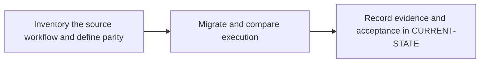

# P7 · GitHub Actions migration

**Prerequisites** — P5, P6. **Effort** — 4–6 hours. **Access** — GitLab + Windows.

Translate workflows, events, jobs and steps, runners, expressions, env/secrets, reusable workflows, caches and artifact transfers. Preserve event and credential semantics.

## Flow to trace

## Bounded implementation steps

### P7.1 · Inventory the source workflow and define parity

**Prerequisites** — Roadmap reviewed and phase dependencies met. Confirm access for the specific lab before starting.

**Scope and deliverable** — Perform the first exercise in the phase and save a reproducible lab note under [labs](../labs/README.md), including sanitized inputs and observed output.

**Verification and expected result** — Read a supplied Rust workflow and record trigger, runner OS, tools, cache keys, test commands and outputs. Predict outcomes for push, PR, fork and manual dispatch.

### P7.2 · Migrate and compare execution

**Prerequisites** — Complete P7.1 and confirm access for the second exercise.

**Scope and deliverable** — Perform the second exercise in isolation, then save the lab instructions, expected results, and a troubleshooting note for the demonstrated failure.

**Verification and expected result** — Create a GitLab sandbox equivalent after review. Validate merged config and run the parity matrix; compare cargo test --locked output, cache warmup and artifact content.

## Acceptance and operational review

Accept P7.1 when its verification is reproducible from the recorded inputs. Accept P7.2 when its verification is repeatable and the learner can meet this phase outcome.

Account for each event, shell, permission and artifact difference with observed or explicitly unavailable evidence.

Use the phase's official references from [concepts](../concepts/README.md) and log each step separately in [CURRENT-STATE.md](../../CURRENT-STATE.md).

## Knowledge check

Which Actions steps need explicit GitLab commands? Where can fork secret exposure differ?
