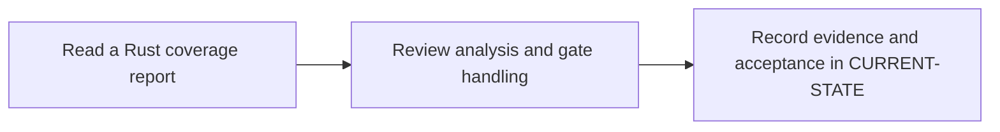

# P8 · SonarQube quality and coverage

**Study effort** — 4–6 hours. **Access** — Offline documentation and configuration reading.

## Purpose and enterprise relevance

Distinguish analyzer findings, coverage import, compute-task completion and gate status. Compare the role with a Maven Sonar invocation.

**Operational target** — L2. Correct an LCOV path or gate-handling configuration and predict failure behavior. Classify a failed import, service timeout or policy decision using the fixture. P12 covers integrated incidents.

## Prerequisites

- **Mandatory** — P2, P5, P6. Use P2 for Rust build inputs, P5 for report transfer and P6 for Windows execution.
- **Optional** — P4 for deeper protected credential review.
- Use the [concept index](../concepts/README.md) for source and version notes. Dependency checks concern the prerequisite knowledge listed here. A learner can use the existing material while earlier expansion work is pending.

## Layer A · Knowledge Base deliverables

**PLANNED chapter** — `docs/concepts/sonarqube-analysis-model.md`

**Subject and learning objective** — SonarQube quality analysis and CI gate model. Build a mental model that transfers across enterprise configurations and failure paths.

### Planned chapter hierarchy

1. **Concepts and definitions.** Define analysis scope, project identity, scanner, coverage report, server task, quality profile and quality gate. Explain coverage production and analysis separately before linking them to enforcement. For each major concept, state why it exists, what problem it solves, what it owns and what it is commonly confused with.
2. **Responsibilities, relationships and usage.** Connect test tooling, GitLab jobs, SonarQube processing and branch or MR presentation. Compare polling/waiting and separate enforcement, version and edition constraints, and Maven scanner usage.
3. **Architecture and internal execution.** Plan a sequence from test and report generation through submission, asynchronous processing and CI decision. Cover invalid paths, authorization failures, queued or failed processing, timeout and rejected gate.
4. **Configuration and enterprise application.** Identify repository inputs, project and server settings, runner tooling and credential ownership. Explain report paths and supported flags before a sample integration. Explain path mapping, credential and edition assumptions, gate wait timeouts and why successful upload does not prove gate pass. Compare Maven Sonar usage.
5. **Selected illustrations.** Select a valid report handoff and an upload-success/gate-failure contrast. Label synthetic records and qualify any Rust capability claims by version. Present these after the relevant explanation and use Layer B for the full reference.
6. **Conclusions and knowledge checks.** Synthesize measured coverage, analysis processing and gate enforcement. Ask which evidence supports each claim. Direct readers to P5 and P11.

**Dependencies and reuse** — Use the mandatory prerequisite knowledge above. Consult [vendor support notes](../concepts/README.md) and [gate triage](../competency-levels/03-L3-TROUBLESHOOT.md) for existing explanations, diagrams or later assessment alignment. Set chapter coverage from the hierarchy above and verify technical claims against authoritative references.

**Knowledge acceptance** — Explain the purpose, boundaries, interactions and material alternatives across the hierarchy. Diagrams and prose must agree for normal and significant alternate or failure paths. End with a synthesis that resolves the named distinctions and a knowledge check that can be answered from the chapter. Review completeness independently of any existing example or L1–L3 target. Plan roughly 1,000–2,000 words for substantial coverage, with room for diagrams and tables.

## Layer B · Practical Reference deliverables

**PLANNED reference** — `docs/references/sonarqube-rust-reference.md`.

- **Technologies and selected illustrations** — Version-qualified scanner settings and report handoff, synthetic LCOV, task and gate records.
- **Syntax, alternatives and depth** — Annotate source/report paths, endpoint, project key, token reference, gate handling and timeout or outage policy; label simulated results. Annotate material lines and explain defaults, tradeoffs, version assumptions and change consequences.
- **Dependencies and reuse** — Complete P8.A before choosing examples. Use existing material where it illustrates the established concepts: [vendor support notes](../concepts/README.md) and [gate triage](../competency-levels/03-L3-TROUBLESHOOT.md).
- **Acceptance** — Supply the configuration or evidence needed to predict the stated outcomes, identify owners and justify a safe alternative. Use complete illustrative files where appropriate, mark them unexecuted and check their structure offline.

## Layer C · Competency Validation deliverables

Apply the [L1–L3 model](../competency-levels/00-COMPETENCY-MODEL.md) and [validation rubric](../competency-levels/04-SUMMARY-VALIDATION.md). Each required level assumes Layers A and B and the knowledge and evidence listed below. Learners work through the required levels in order. The mapping below identifies evidence for selected capabilities already taught. Conceptual coverage may extend beyond the exercises and the initial competency target.

| Level | Expected capability and required knowledge | Exercise | Assessment evidence |
|---|---|---|---|
| L1 · Understand | Trace coverage to its source commit and distinguish task and gate states. Requires the Layer A definitions and flow. | P8.1 report reading. | Annotated explanation citing the relevant configuration or trace and identifying the responsible component. |
| L2 · Modify | Correct an LCOV path or gate-handling configuration and predict failure behavior. Requires L1 and the Layer B syntax and ownership rules. | P8.2 analysis and gate configuration review. | A bounded change or review decision with predicted outcomes, regression risk and applicable rollback. |
| L3 · Troubleshoot (optional initially) | Classify a failed import, service timeout or policy decision using the fixture. P12 covers integrated incidents. Requires L2 and the Layer B failure evidence. | Optional failure variant of P8.2. | A ranked hypothesis, decisive evidence, scoped correction and recovery check. |

**Exercise source** — The named P8.1/.2 exercises will be sections of the PLANNED pack `docs/labs/p8-phase-validation.md`. Reuse related material linked below and extend only where phase-specific evidence is needed.

## Educational gaps

- **EXISTING / ADEQUATE** for the stated baseline — The shared gate triage distinguishes upload and policy decisions at an introductory level. Evidence: [vendor support notes](../concepts/README.md) and [gate triage](../competency-levels/03-L3-TROUBLESHOOT.md).
- **EXISTING / NEEDS EXPANSION** for full phase coverage — Review [vendor support notes](../concepts/README.md) and [gate triage](../competency-levels/03-L3-TROUBLESHOOT.md) against Layer A. Dedicated Rust coverage/analysis chapter and annotated version-qualified job, report and gate reference.
- **MISSING / PLANNED** — The dedicated Layer A chapter and Layer B reference above. The phase-specific validation pack and worked answers are planned under the retained steps.

## Implementation steps

### P8.A · Develop the Knowledge Base chapter

**Status** — PLANNED.

**Scope and inputs** — Develop the subject in the order specified by the Layer A hierarchy. Use prerequisite knowledge and technical references to establish scope, then consult existing material for reuse.

**Expected Markdown deliverable** — `docs/concepts/sonarqube-analysis-model.md`.

**Dependencies** — Mandatory prerequisite knowledge above.

**Acceptance and documentation validation** — Meet Layer A acceptance. Trace each diagram through the prose, check normal and alternate paths against official references, and review the synthesis and knowledge checks independently of the labs.

### P8.B · Develop the Practical Reference

**Status** — PLANNED.

**Scope and inputs** — Select and annotate Layer B examples that clarify the completed subject model. Explain why each example is useful and what assumptions it makes.

**Expected Markdown deliverable** — `docs/references/sonarqube-rust-reference.md`.

**Dependencies** — P8.A.

**Acceptance and documentation validation** — Meet Layer B acceptance. Review annotated examples for syntax, compatible assumptions and deterministic expected outcomes; check Markdown links and file relationships.

### P8.1 · Read a Rust coverage report

**Status** — PLANNED.

**Prerequisites** — Read the relevant prerequisite phase notes.

**Scope and deliverable** — Trace LCOV paths from a Cargo test run to SonarQube and diagnose a failed import. Save annotated examples and a worked answer.

**Verification** — Compare predictions with the official reference and verify that the worked answer follows from the supplied inputs.

**Educational dependencies** — P8.B must be complete before this step.

**Inputs** — Layer A, Layer B and the referenced existing material.

**Expected Markdown deliverable** — the P8.1 exercise and answer section of the PLANNED validation pack `docs/labs/p8-phase-validation.md`.

**Acceptance and documentation validation** — Check the prompt against the stated evidence and expected answer in the corresponding Layer C capability. Verify references and version assumptions offline.

### P8.2 · Review analysis and gate handling

**Status** — PLANNED.

**Prerequisites** — Complete P8.1.

**Scope and deliverable** — Interpret synthetic task and gate results and distinguish an upload, a timeout and a failed gate. Save a reading exercise, answer key and troubleshooting notes.

**Verification** — Walk through the exercise offline and check the predicted outcome and diagnostic path against the example.

**Educational dependencies** — P8.B must be complete before this step, and P8.1 must supply the reading baseline.

**Inputs** — Layer A, Layer B and the referenced existing material.

**Expected Markdown deliverable** — the P8.2 exercise and answer section of the PLANNED validation pack `docs/labs/p8-phase-validation.md`.

**Acceptance and documentation validation** — Check the prompt against the stated evidence and expected answer in the corresponding Layer C capability. Verify references and version assumptions offline.

### P8.C · Verify education coverage

**Status** — PLANNED.

**Scope and inputs** — Compare both layers and the retained P8.1/P8.2 deliverables with the Layer C table.

**Expected Markdown deliverable** — the planned validation pack at `docs/labs/p8-phase-validation.md`, plus its coverage and scoring crosswalk in this phase specification.

**Dependencies** — P8.A, P8.B, P8.1 and P8.2.

**Acceptance and documentation validation** — Walk through required assessments offline, verify each answer uses documented concepts and references, and close or explicitly classify gaps. Check links, fixture consistency and the phase status.

## Phase completion criteria

- **Knowledge complete** — P8.A meets its acceptance criteria, with definitions, component relationships and internal flows supported by diagrams.
- **Reference complete** — P8.B provides the stated enterprise scenario with annotated examples and tradeoffs.
- **Validation ready** — P8.C confirms that all required levels through L2 are assessable, including the existing or planned work in P8.1 and P8.2.
- **Education complete** — All three layers meet their criteria. Verify internal consistency from diagrams to settings, traces and answer keys. Judge conceptual breadth against the subject hierarchy and assess competency alignment separately. Phase-specific exit evidence: Prove the analyzed commit, imported coverage and quality gate decision agree.
- **Live validation deferred** — Runtime evidence is tracked separately in [Future labs](../../FUTURE-LABS.md). Historical step progress is in [CURRENT-STATE.md](../../CURRENT-STATE.md).

## Flow to trace

## Knowledge check

Can a successful upload mean the gate failed? How do broken LCOV paths appear?
