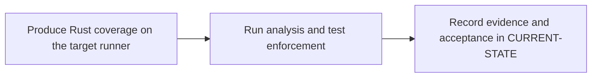

# P8 · SonarQube quality and coverage

**Prerequisites** — P2, P5, P6. **Effort** — 4–6 hours. **Access** — Local + GitLab + Vendor for licensed features.

Distinguish analyzer findings, coverage import, compute-task completion and gate status. Compare the role with a Maven Sonar invocation.

## Flow to trace

## Bounded implementation steps

### P8.1 · Produce Rust coverage on the target runner

**Prerequisites** — Roadmap reviewed and phase dependencies met. Confirm access for the specific lab before starting.

**Scope and deliverable** — Perform the first exercise in the phase and save a reproducible lab note under [labs](../labs/README.md), including sanitized inputs and observed output.

**Verification and expected result** — Verify a pinned coverage producer against its help and official docs. Generate LCOV for the tested commit and confirm source paths and nonzero covered lines.

### P8.2 · Run analysis and test enforcement

**Prerequisites** — Complete P8.1 and confirm access for the second exercise.

**Scope and deliverable** — Perform the second exercise in isolation, then save the lab instructions, expected results, and a troubleshooting note for the demonstrated failure.

**Verification and expected result** — Check target server Rust support and scanner version; run SonarScanner with the documented Rust LCOV property and gate wait. Capture the task ID and observed pass, gate failure and timeout outcomes.

## Acceptance and operational review

Accept P8.1 when its verification is reproducible from the recorded inputs. Accept P8.2 when its verification is repeatable and the learner can meet this phase outcome.

Prove the analyzed commit, imported coverage and quality gate decision agree.

Use the phase's official references from [concepts](../concepts/README.md) and log each step separately in [CURRENT-STATE.md](../../CURRENT-STATE.md).

## Knowledge check

Can a successful upload mean the gate failed? How do broken LCOV paths appear?
