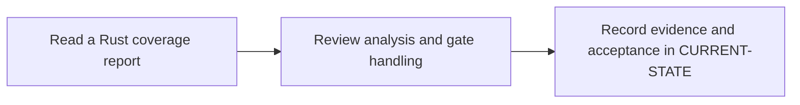

# P8 · SonarQube quality and coverage

**Prerequisites** — P2, P5, P6. **Effort** — 4–6 hours. **Access** — Offline documentation and configuration reading.

Distinguish analyzer findings, coverage import, compute-task completion and gate status. Compare the role with a Maven Sonar invocation.

## Flow to trace

## Bounded documentation steps

### P8.1 · Read a Rust coverage report

**Prerequisites** — Read the relevant prerequisite phase notes.

**Scope and deliverable** — Trace LCOV paths from a Cargo test run to SonarQube and diagnose a failed import. Save annotated examples and a worked answer.

**Verification** — Compare predictions with the official reference and verify that the worked answer follows from the supplied inputs.

### P8.2 · Review analysis and gate handling

**Prerequisites** — Complete P8.1.

**Scope and deliverable** — Interpret synthetic task and gate results and distinguish an upload, a timeout and a failed gate. Save a reading exercise, answer key and troubleshooting notes.

**Verification** — Walk through the exercise offline and check the predicted outcome and diagnostic path against the example.

## Acceptance and operational review

Mark this phase DOCUMENTATION COMPLETE when the explanations, annotated examples, troubleshooting guide and knowledge assessment are ready. Evaluate the following outcome by reading the supplied examples. [Future runtime lab](../../FUTURE-LABS.md).

Prove the analyzed commit, imported coverage and quality gate decision agree.

Use the phase's official references from [concepts](../concepts/README.md) and log each step separately in [CURRENT-STATE.md](../../CURRENT-STATE.md).

## Knowledge check

Can a successful upload mean the gate failed? How do broken LCOV paths appear?
