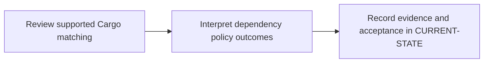

# P9 · Nexus IQ dependency policy

**Prerequisites** — P2, P5, P6. **Effort** — 3–5 hours. **Access** — Offline documentation and configuration reading.

Separate Cargo package proxying from Lifecycle policy evaluation. Compare Rust lockfile coordinates with Maven GAV, and study license rules and waivers.

## Flow to trace

## Bounded documentation steps

### P9.1 · Review supported Cargo matching

**Prerequisites** — Read the relevant prerequisite phase notes.

**Scope and deliverable** — Trace Cargo.lock coordinates through a version-qualified Lifecycle evaluation example. Save annotated examples and a worked answer.

**Verification** — Compare predictions with the official reference and verify that the worked answer follows from the supplied inputs.

### P9.2 · Interpret dependency policy outcomes

**Prerequisites** — Complete P9.1.

**Scope and deliverable** — Classify warn, block and operational error fixtures and explain what each report proves. Save a reading exercise, answer key and troubleshooting notes.

**Verification** — Walk through the exercise offline and check the predicted outcome and diagnostic path against the example.

## Acceptance and operational review

Mark this phase DOCUMENTATION COMPLETE when the explanations, annotated examples, troubleshooting guide and knowledge assessment are ready. Evaluate the following outcome by reading the supplied examples. [Future runtime lab](../../FUTURE-LABS.md).

Correlate a decision with an actual component and policy or label it as simulated.

Use the phase's official references from [concepts](../concepts/README.md) and log each step separately in [CURRENT-STATE.md](../../CURRENT-STATE.md).

## Knowledge check

Why does a successful Nexus Repository download say nothing about an IQ policy?
