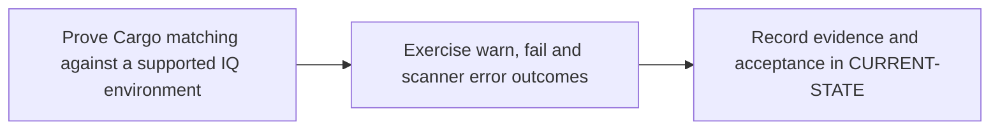

# P9 · Nexus IQ dependency policy

**Prerequisites** — P2, P5, P6. **Effort** — 3–5 hours. **Access** — Local simulation + GitLab + licensed Vendor.

Separate Cargo package proxying from Lifecycle policy evaluation. Compare Rust lockfile coordinates with Maven GAV, and study license rules and waivers.

## Flow to trace

## Bounded implementation steps

### P9.1 · Prove Cargo matching against a supported IQ environment

**Prerequisites** — Roadmap reviewed and phase dependencies met. Confirm access for the specific lab before starting.

**Scope and deliverable** — Perform the first exercise in the phase and save a reproducible lab note under [labs](../labs/README.md), including sanitized inputs and observed output.

**Verification and expected result** — Confirm CLI/server compatibility, Rust support and the required application role. Evaluate a controlled Cargo.lock with the documented CLI and verify resolved coordinates in the report.

### P9.2 · Exercise warn, fail and scanner error outcomes

**Prerequisites** — Complete P9.1 and confirm access for the second exercise.

**Scope and deliverable** — Perform the second exercise in isolation, then save the lab instructions, expected results, and a troubleshooting note for the demonstrated failure.

**Verification and expected result** — Use authorized sandbox policies or labeled fixtures. Record application, stage, policy action and exit behavior; distinguish no matches, a policy violation and transport failure.

## Acceptance and operational review

Accept P9.1 when its verification is reproducible from the recorded inputs. Accept P9.2 when its verification is repeatable and the learner can meet this phase outcome.

Correlate a decision with an actual component and policy or label it as simulated.

Use the phase's official references from [concepts](../concepts/README.md) and log each step separately in [CURRENT-STATE.md](../../CURRENT-STATE.md).

## Knowledge check

Why does a successful Nexus Repository download say nothing about an IQ policy?
